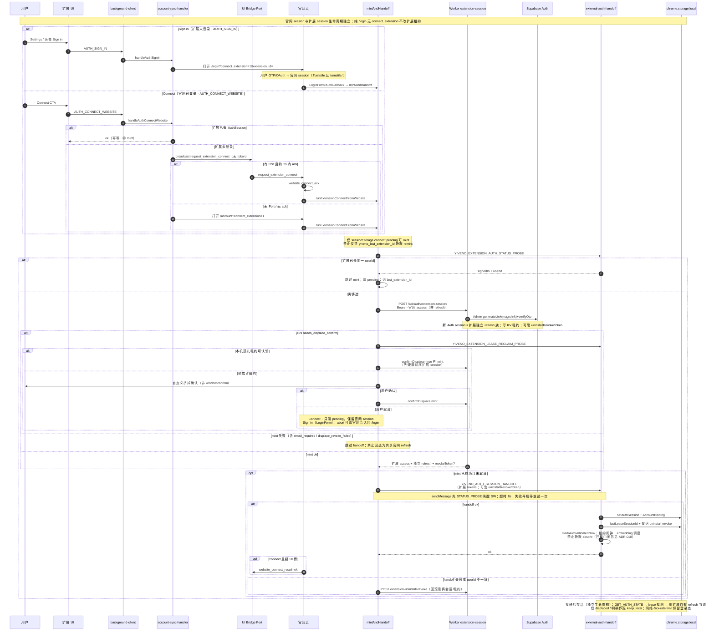
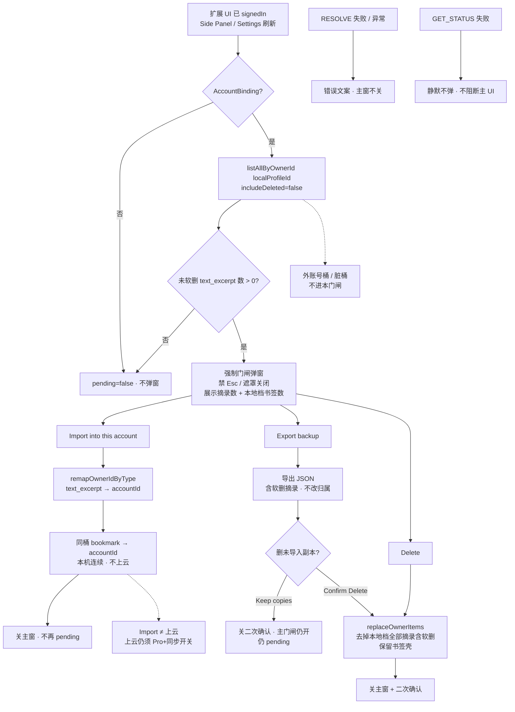

# 认证系统使用指南

> **最后更新：** 2026-10-31  
> **状态：** Phase C 主路径 = **官网 Supabase Auth**（Email OTP + Google / Microsoft OAuth）→ Worker **mint** 扩展独立 session → handoff。  
> Worker 遗留的自建 OAuth → 自定义 JWT（`/api/auth/start|callback`）**不是**用户主路径。  
> **扩展接通时序图：** §「扩展 Session mint / handoff」· registry `auth.extension-session-mint-handoff`（报告：[`docs/diagrams/reports/2026-10-Auth-Extension-Session图表补齐.md`](./diagrams/reports/2026-10-Auth-Extension-Session图表补齐.md)）。  
> **登录迁移门闸：** §「登录迁移门闸」· registry `auth.login-migration-gate`（报告：[`docs/diagrams/reports/2026-10-Auth-Login-Migration-Gate图表补齐.md`](./diagrams/reports/2026-10-Auth-Login-Migration-Gate图表补齐.md)）。

## 概述

1. **用户在官网 `/login` 登录**（扩展 Settings / 头像「Sign in」只打开该页，**不**弹本机 OAuth）。
2. 登录方式（并列）：
   - **Email OTP**：输入邮箱 → Supabase 发信 → **同页邮箱框保留**，下方出现 **8 位**码输入 `verifyOtp`（邮件内 magic link 亦可落 `/auth/callback`）。位数由 Dashboard **Email OTP length** 与仓内 `EMAIL_OTP_LENGTH`（`website/src/services/auth-email.ts`）对齐，**精确匹配、无区间**。冷却未尽时刷新/后退恢复邮箱+码区；码区态邮箱只读，**换邮箱**（en：_Use a different email_；`website/src/i18n`）清 `sessionStorage` 冷却并收起码区后可换址重发。`/login` 用户可见文案经官网 `t()`（en / zh_CN）。
   - **Google / Microsoft**：Supabase `signInWithOAuth` → `/auth/callback`。
3. 若本次带 `connect_extension=1`：官网用当前 access 调 Worker `POST /api/auth/extension-session` 铸造**扩展专用** session → `YIVENO_AUTH_SESSION_HANDOFF`。
4. 纯官网登录（无 connect）**不**改扩展租约；扩展靠 Connect / UI 桥接通（ADR-018 / ADR-019）。

权威行为契约：产品文档 **§登录态对齐**；身份隔离见 ADR-018；UI 桥见 ADR-019。

---

## 登录方式（用户向）

| 方式                 | UI                                                                   | 技术                                             | 大陆可达性                                                      |
| -------------------- | -------------------------------------------------------------------- | ------------------------------------------------ | --------------------------------------------------------------- |
| **Email OTP**        | `/login` 顶部                                                        | `signInWithOtp` + `verifyOtp({ type: 'email' })` | 高（依赖邮箱可达）                                              |
| Magic link（同邮件） | 邮件内链接                                                           | 回跳 `/auth/callback`（hash / PKCE）             | 同左；部分邮件客户端内嵌浏览器可能丢会话，故 UI **以 OTP 为主** |
| Google OAuth         | 仅 logo 按钮（与 Microsoft **并排**；`title`/`aria-label` 保留文案） | Supabase `provider: google`                      | 大陆常需翻墙                                                    |
| Microsoft OAuth      | 同上                                                                 | Supabase `provider: azure` + scopes 含 `email`   | 大陆常需翻墙                                                    |

**未上线：** 手机号短信、微信、邮箱密码。

---

## 运维清单（Email 必须）

在 **Supabase Dashboard → Authentication** 确认：

1. **Email** provider **Enabled**（允许注册 / 登录）。
2. 邮件模板（Magic Link / OTP）：Dashboard **Authentication → Emails**；权威 HTML 见 [`docs/engineering/supabase-auth-email-magic-link.html`](./engineering/supabase-auth-email-magic-link.html)（须含 **`{{ .Token }}`** + **`{{ .ConfirmationURL }}`**）。Subject 建议：`Your Yiveno sign-in code`。正文写明有效期（当前 **1 hour**），须与 Providers → Email → **Email OTP expiration**（默认 3600s）一致；改秒数时同步改模板文案。**Email OTP length**（当前 **8**）须与 `EMAIL_OTP_LENGTH` 同改。
3. Redirect URLs 含官网 `/auth/callback`（含生产与本地 `localhost`）。
4. **自定义 SMTP**：**阿里云邮件推送（DirectMail）**（按封计费，非企业邮箱席位）。发信地址须已验证域名 + 已设 SMTP 密码；Supabase **Emails → SMTP Settings** 填 DirectMail 主机（见下表）。发件显示名用 `Yiveno`（勿留 `AcuityBookmarks`）。旧 Zoho SMTP 可废弃。
5. **Captcha（必开 · Email OTP 防刷）**：Dashboard **Authentication → Attack Protection** → Enable Captcha → Provider **Turnstile** → 填 Secret。官网 `LoginForm` 渲染 Turnstile，`signInWithOtp` 传 `captchaToken`（见 `website/src/services/turnstile.ts`）。环境变量：`PUBLIC_TURNSTILE_SITE_KEY`（仅公钥，进官网 / Pages）；**Secret 只配 Supabase，禁止进 git / 官网 bundle**。Cloudflare 小组件（当前 **`yiveno-login` · region=`world`**）域名须含 `localhost`、`yiveno.com`、`yiveno.cn`（及 www）。**生命周期 / 流程图 / 国内 china 区域：** [`docs/engineering/Turnstile-Email-OTP-防刷生命周期.md`](./engineering/Turnstile-Email-OTP-防刷生命周期.md)。大陆可达性：`world` 在部分运营商下可能慢或失败 → UI 提示 Google / Microsoft 或刷新。**`region: china` 需账号 entitlement**（本仓 2026-10-27 实测创建返回 `not entitled to create widgets with this region`）；且 china/world **各有独立 secret**，而 Supabase 只收 **一个** Captcha secret → 双区域须另做 Worker 双 Siteverify，不能只换 Dashboard 里那一个 secret。

### Supabase ← 阿里云 DirectMail SMTP（标准填法）

| Supabase 字段    | 填什么                                                                      |
| ---------------- | --------------------------------------------------------------------------- |
| Sender email     | `noreply@yiveno.com`（须与控制台「发信地址」完全一致）                      |
| Sender name      | `Yiveno`                                                                    |
| Host             | `smtpdm.aliyun.com`（若控制台发信地址页写了区域专属主机，以控制台为准）     |
| Port             | `465`（SSL）                                                                |
| Username         | 完整发信地址，如 `noreply@yiveno.com`（**必须与发件人一致**）               |
| Password         | 控制台「发信地址 → 设置 SMTP 密码」里设的那串（**不是**阿里云账号登录密码） |
| Minimum interval | 可先 `60`（秒）；与 Auth rate limit、官网 UI 冷却一并调                     |

**官网重发冷却（UX）：** `LoginForm` 发码成功后将截止时间写入 **`sessionStorage`**（键 `yiveno.otpResendCooldown`，默认 **60s**，与上表对齐）。同标签**刷新 / 后退**恢复剩余秒数与 Code 区，**不**再自动发信；关标签丢弃。**换邮箱：** 码区下 **换邮箱** 链接（en：_Use a different email_；或手动改成另一地址）须 **清冷却键** 并收起码区，避免刷新又拉回旧邮箱。刷新绕不开服务端限流。实现：`website/src/services/otp-resend-cooldown.ts`。

控制台入口：[邮件推送](https://dm.console.aliyun.com/) → 开通 → **发信域名**（DNS 验证）→ **发信地址** → **设置 SMTP 密码**。

**与 Pro 欢迎信的关系：** OTP 走本表 SMTP（Supabase 代发 `noreply@`）；欢迎信由 Worker 调 DirectMail **API**（`hello@`，Secrets `ALIYUN_DM_*`）。同属 DirectMail 产品/配额，**不是**同一条发送链路。详见产品文档 §A.3 / `docs/billing.md`。

**域名建议：** 根域 `yiveno.com` 若已挂企业邮箱 / 其它 MX，优先用子域发信（如 `mail.yiveno.com` → 发件人 `noreply@mail.yiveno.com`），避免 MX/SPF 冲突；若根域仅作品牌发信且无收信邮箱冲突，可用 `yiveno.com`。DNS 以控制台「配置」页给出的 TXT/MX/DKIM/DMARC 为准。

**noreply 与回复：** DirectMail 发信地址**通常无收件能力**（用户点 Reply 往往投递失败或无人看）。OTP 模板页脚须写明 _automated / don’t reply_，并引导 **`support@yiveno.com`**（见 magic-link HTML 草稿）。不要把用户支持期望绑在 `noreply@…` 上。

未配好 Email/SMTP 时，邮箱发码主按钮（en：_Email me a code_）会失败；Google / Microsoft 不受影响。

---

## 关键代码路径

| 面                    | 路径                                                 | 职责                                                        |
| --------------------- | ---------------------------------------------------- | ----------------------------------------------------------- |
| 官网登录 UI           | `website/src/components/LoginForm.vue`               | Email OTP + OAuth；connect 收尾                             |
| 官网 Auth API         | `website/src/services/auth.ts`                       | `signInWithOAuth` / `signInWithEmailOtp` / `verifyEmailOtp` |
| 邮箱格式              | `website/src/services/auth-email.ts`                 | 校验 / 规范化                                               |
| OAuth·magic link 回调 | `website/src/components/AuthCallback.vue`            | setSession / exchangeCode → mint                            |
| 扩展 mint             | `worker/src/services/auth/mint-extension-session.ts` | 独立 refresh；须有 email                                    |
| 扩展收 session        | `extension/.../external-auth-handoff.ts`             | 校验后写入；**不**发起 OAuth                                |

---

## 环境变量（相关）

见 `docs/ENVIRONMENT.md`。

- 官网：`PUBLIC_SUPABASE_URL` / `PUBLIC_SUPABASE_ANON_KEY`
- 遗留 Worker OAuth（非主路径）：`AUTH_GOOGLE_*` / `AUTH_MICROSOFT_*` / `JWT_SECRET` / `REDIRECT_URI_ALLOWLIST`

---

## 常见问题

### Q: 为什么不在扩展里弹 Google 登录？

A: 产品规定官网为唯一用户向登录壳；扩展只接收 handoff 的独立 session（避免 chrome.identity 主路径与双会话契约冲突）。

### Q: 中国用户怎么登录？

A: 用 **Email OTP**（可达邮箱）。Google / Microsoft 在大陆常不可用，仍保留给海外用户。

### Q: 同一邮箱先 Google 再 Email 会怎样？

A: **自动关联（Automatic linking）默认始终开启，Dashboard 没有开关可关**（官方文档 + 社区确认）。同一**已验证**邮箱的 Google / Email OTP / Microsoft 会落到**同一个** `auth.users` 行。Dashboard 里能看到的是 **Allow manual linking**（`GOTRUE_SECURITY_MANUAL_LINKING_ENABLED` / 本地 `enable_manual_linking`）——那是给**不同邮箱**在已登录态用 `linkIdentity()` 手动绑身份用的，与「同邮箱自动合并」无关；本仓默认关、产品面也不做跨 provider 人工合并 UI。

### Q: mint 为什么要求 email？

A: Worker 用 Admin magiclink 路径铸造扩展 session；无 email → `email_required`。故新 IdP 也须产出带 email 的 user（或先改 mint 契约）。

---

## 扩展 Session mint / handoff（官网 → 扩展）

> **范围：** 已有**官网** session 之后，如何铸造**扩展独立** session 并写入扩展本机。  
> **不含：** Turnstile / OTP / OAuth 建立官网 session（见 `turnstile.*`）；扩展→官网反铸 `website-session`；登录迁移门闸（见下节 `auth.login-migration-gate`）；Pro 云同步；遗留 `YIVENO_AUTH_SIGN_OUT_HANDOFF`（新产品路径官网退出**不**踢扩展）。  
> **安全铁律（代码 + Normative 一致）：** 扩展持有**独立** refresh；**禁止**把官网 refresh 直接 handoff；Connect ≠ Sign in；access / refresh / `uninstallRevokeToken` / handoff 载荷**勿混为同一凭证**。

凭证分工（读图前先分清）：

| 凭证                                           | 谁持有                                  | 用途                                                   |
| ---------------------------------------------- | --------------------------------------- | ------------------------------------------------------ |
| 官网 `access_token`                            | 官网 Supabase session                   | 仅作 Worker mint 的 Bearer；**不**写入扩展 AuthSession |
| 扩展 `access_token` + **独立** `refresh_token` | 扩展 `chrome.storage.local`             | handoff 写入；日后 refresh / 调 API                    |
| `uninstallRevokeToken`                         | mint 响应 → handoff 旁路登记 / 失败回滚 | 一次性销扩展会话 + KV 租约；**不是** refresh           |
| UI 桥 Port 消息                                | 同浏览器编排                            | **禁止**传任何 token（ADR-019）                        |

<!-- diagram: id=auth.extension-session-mint-handoff kind=sequence status=implemented -->

**入口对照（勿混）：**

| 入口       | message / 路径                                                  | 何时用                                     |
| ---------- | --------------------------------------------------------------- | ------------------------------------------ |
| Sign in    | `AUTH_SIGN_IN` → `/login?connect_extension=1`                   | 扩展**未**登录；须用户在官网完成 OTP/OAuth |
| Connect    | `AUTH_CONNECT_WEBSITE` → Port 或 `/account?connect_extension=1` | 官网**已**登录；**禁止**先开登录壳         |
| 纯官网登录 | `/login` 无 connect                                             | **不** mint、**不**改扩展租约              |

**故意不画进本图：** `YIVENO_WEBSITE_SESSION_REQUEST`（扩展→官网反铸）；登录迁移三选一 UI（下节）；云同步门禁；卸载落地页全时序（仅涉及 revoke token 回滚边）。

---

## 登录迁移门闸（无主摘录 · ADR-018）

> **范围：** 扩展**已**有 AccountBinding 之后，如何识别「未登录期间写在 `localProfileId` 的 `text_excerpt`」，以及 Import / Export / Delete 对归属的后果。  
> **不含：** mint/handoff 本身（上节）；静默 absorb（**已拆除**）；外账号脏桶孤儿清理（Settings 旁路）；云同步对齐（ADR-017 · `sync.excerpt-cloud-pro-gate`）。  
> **无主定义（代码 = Normative）：** 仅 `localProfileId` 桶上、未软删（盘点）或含软删（Export/Delete）的 `text_excerpt`；**不**扫 `ownerId≠accountId` 的外账号桶。

**触发（UI 轮询，非 handoff 内联）：** Side Panel `loadGreetingIdentity` / Settings `loadSyncContext` 在 `signedIn` 时调 `GET_LOGIN_MIGRATION_STATUS` → `summarizeLoginMigrationForCurrentBinding`。无 binding、或本地档无未软删摘录 → `pending=false`、不弹窗。

**主弹窗关闭策略（实现证据）：** `LoginMigrationDialog` → `AppModal`：`close-on-escape=false`；无关闭钮、点遮罩不关、**无** `@close` 处理——用户必须点 Import / Export / Delete 之一。**不存在**「取消 = 拒绝迁移」主按钮。

<!-- diagram: id=auth.login-migration-gate kind=flowchart status=implemented -->

**三选一后果（勿合并）：**

| 用户动作                                      | 摘录归属                                             | 本地档书签                                         | 弹窗                          |
| --------------------------------------------- | ---------------------------------------------------- | -------------------------------------------------- | ----------------------------- |
| **Import**                                    | `localProfileId` → `accountId`（含软删行一并 remap） | 一并 remap 到账号桶（Recall 本机连续；**不上云**） | 成功关主窗                    |
| **Export**                                    | **不变**；下载 `yiveno-login-migration-*.json`       | 不动                                               | 主窗仍开；再问是否 Delete     |
| **Export → Keep copies**                      | 仍无主                                               | 不动                                               | 主窗继续挡（仍 pending）      |
| **Export → Confirm Delete** 或直接 **Delete** | 本地档摘录硬清（含软删）；**不做内容去重**           | 保留                                               | 关窗                          |
| **失败**                                      | 不变                                                 | 不变                                               | 主窗不关 + error              |
| **「取消主窗」**                              | —                                                    | —                                                  | **未实现**（无 Esc/无关闭钮） |

handoff 成功路径只标「禁止静默 absorb」；**真正弹窗**靠上述 UI 刷新，与 `auth.extension-session-mint-handoff` **分图**。

---

## 相关文档

- [Yiveno 产品文档 v4.0](./product/Yiveno-产品文档-v4.0.md) §登录态对齐
- [ADR-018](./architecture/decisions/ADR-018-account-profile-data-isolation.md)
- [ADR-019](./architecture/decisions/ADR-019-website-extension-ui-bridge.md)
- [ENVIRONMENT](./ENVIRONMENT.md)
- [图表 registry](./diagrams/registry.json) · `auth.extension-session-mint-handoff` · `auth.login-migration-gate`
