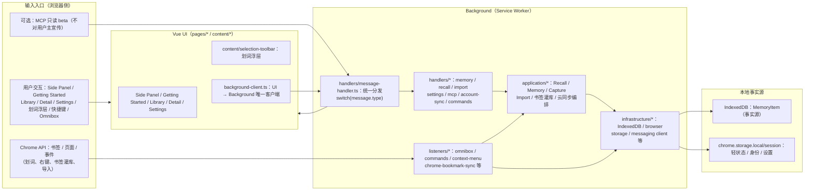
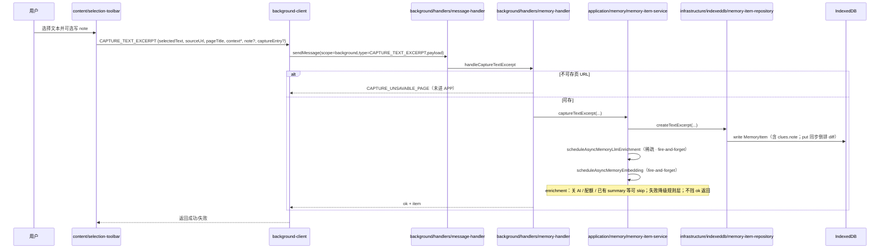
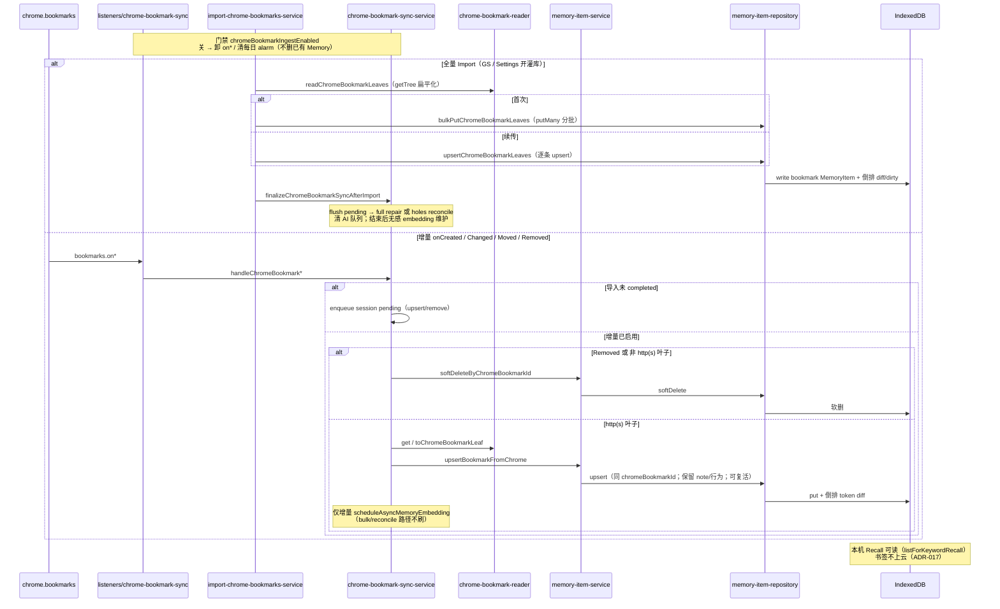
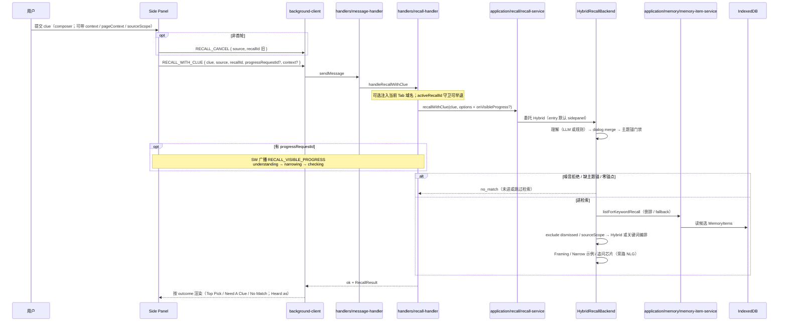
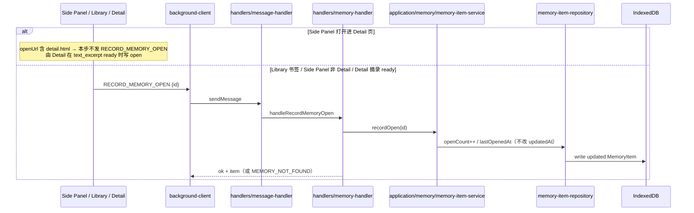
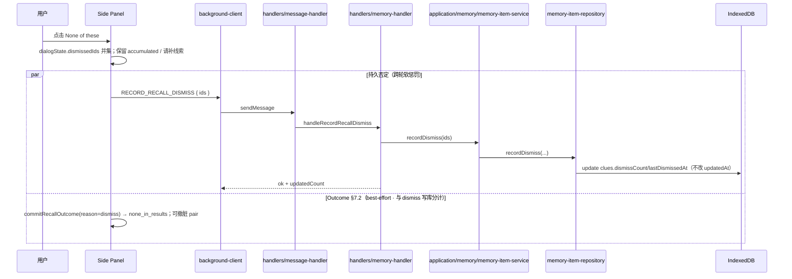
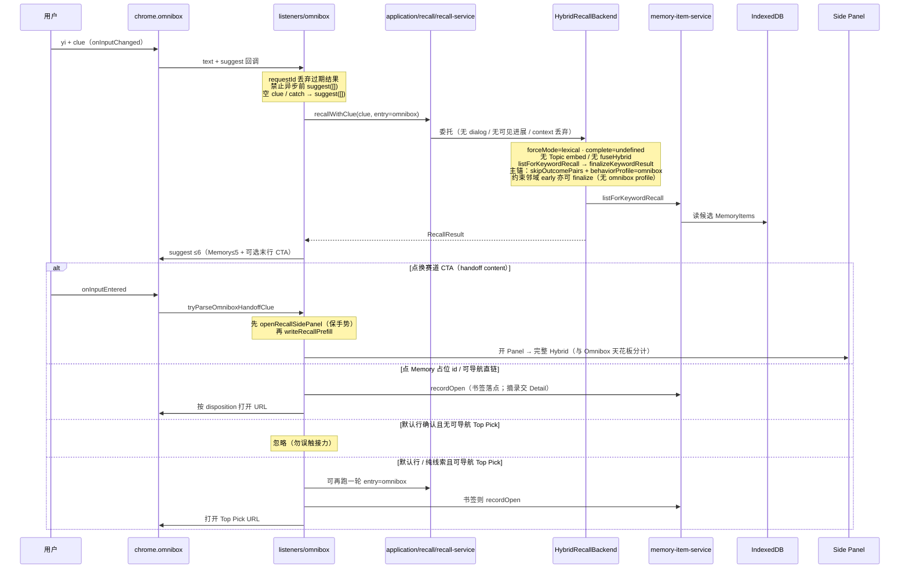

## Yiveno 运行时架构流程（最终版 v1）

> **状态（2026-10-30）：P0–P2 主链路已校正 · 仍非全量实现快照。**  
> 已校正：§0–§2.6、§3.1–§3.7、§4–§9、附录 A（含 Capture / 书签灌库、Open 落点、消息域指针、must/MCP、全景入口）。  
> **Recall 登记图（2026-10-30）：** `runtime.recall-sidepanel-sequence` / `runtime.dismiss-feedback-sequence` 已对照 Hybrid 实现语义同步；报告见 [`docs/diagrams/reports/2026-10-Recall图表语义同步.md`](../diagrams/reports/2026-10-Recall图表语义同步.md)。  
> **Capture / Open 登记图（2026-10-31）：** `runtime.capture-excerpt-sequence` / `runtime.open-record-sequence` 已逐边对照实现；报告见 [`docs/diagrams/reports/2026-10-Capture-Open图表语义复审.md`](../diagrams/reports/2026-10-Capture-Open图表语义复审.md)。  
> **Outcome 多通道总览（2026-10-31）：** `recall.outcome-settlement-channels`（§7.2）；报告见 [`docs/diagrams/reports/2026-10-Outcome-Settlement图表补齐.md`](../diagrams/reports/2026-10-Outcome-Settlement图表补齐.md)。
> **Omnibox 离线快跳（2026-10-31）：** `runtime.omnibox-offline-recall`（§3.5 · ADR-007）；初登见 [`docs/diagrams/reports/2026-10-Omnibox-Offline-Recall图表补齐.md`](../diagrams/reports/2026-10-Omnibox-Offline-Recall图表补齐.md)；第十六阶段语义复核见 [`docs/diagrams/reports/2026-10-Omnibox-Offline-Recall语义复核.md`](../diagrams/reports/2026-10-Omnibox-Offline-Recall语义复核.md)。
> **书签 Chrome→IDB 灌库（2026-10-31）：** `runtime.bookmark-chrome-ingest`（§3.1.1 · ≠ 划词 Capture · 不上云）；报告见 [`docs/diagrams/reports/2026-10-Bookmark-Chrome-Ingest图表补齐.md`](../diagrams/reports/2026-10-Bookmark-Chrome-Ingest图表补齐.md)。  
> **仍以代码 + 产品文档 / ADR / registry 为准**的部分：完整 message 清单、Hybrid 算法细节、Settings/云同步/Account 深路径。  
> 漂移记录：[`docs/audits/2026-10-运行时架构文档与实现漂移.md`](../audits/2026-10-运行时架构文档与实现漂移.md)。  
> **纪律：** 勿把架构长文默认当成 HEAD 同刻快照；先对代码与最新产品文档，再决定本文哪些段需要更新。
> 面向“避免以后走弯路”的工程化梳理：把产品主链路（Capture → Recall → Open → feedback）与代码级实现链路（UI → background-client → Background handler → application/service → core → infrastructure/IndexedDB）对齐。

## 0. 权威来源与本文件边界

### 0.1 权威来源（不冲突）

- [`Yiveno-术语表.md`](../product/Yiveno-术语表.md)：概念叫法唯一权威（clue、Recall、附注、邻域等）。
- [`CURRENT.md`](../product/CURRENT.md)：当下焦点与本周 scope（新会话先读）。
- [`architecture/decisions/`](../architecture/decisions/)：不可逆架构决策（ADR）。
- `docs/product/Yiveno-产品文档-v4.0.md`：核心路线、资产/边界/隐患、找体验规范（尤其 §0.1 / §0.1.1 / §7）。
- `.cursor/rules/project.mdc` + `AGENTS.md`：分层与代码硬约束（唯一监听者、IndexedDB 唯一入口、消息契约先于实现等）。

> **与本文冲突时：** 上表 + 现行代码优先于本文正文；本文不是 Normative 产品契约，也不是实现清单的自动真理源。

### 0.2 本文件覆盖范围

- 系统分层与数据流（运行时）
- 关键产品流程的运行时“端到端链路”
- 消息契约（message type / handler / background-client 映射）
- 未来新增能力时的“标准改动流程”（避免引入架构回潮）
- 对 Recall 主链路的几个产品关键不变量（Top Pick / Need A Clue / dismissCount）

### 0.3 本文件不覆盖

- 新能力的算法细节推导
- UI 细节像素级样式
- Hybrid / embedding / 倒排 / 云同步的**完整算法与运维方案**（这些多数已接线；细节见产品文档 §1、工程文档与 ADR，勿再把本文当「未上线预留」）

## 1. 系统全景架构图（运行时）

> 关键词：**单向数据流**、**Background 唯一监听者**、**IndexedDB 唯一事实源**。

<!-- diagram: id=runtime.system-overview kind=flowchart status=implemented -->



**术语分流（避免「sync」多义）：**

| 说法                            | 含义                                                                         | 详图                                                                                       |
| ------------------------------- | ---------------------------------------------------------------------------- | ------------------------------------------------------------------------------------------ |
| **书签灌库**（Bookmark Ingest） | Chrome 书签树 → 本机 IDB；模块名可含 `chrome-bookmark-sync*`，**不是**云同步 | `runtime.bookmark-chrome-ingest`（本文 §3.1.1）                                            |
| **云同步**（Cloud Sync）        | Pro + 登录 + 开关；面仅 `text_excerpt`；书签不上云                           | `sync.excerpt-cloud-pro-gate`（[ADR-017](./decisions/ADR-017-cloud-sync-excerpt-only.md)） |
| Settings「持续同步」书签开关    | 产品面文案 = 本机灌库持续开；**禁止**写成云记忆 sync                         | 同书签灌库图                                                                               |

**跨图导航（本图保持高层；细节不复制进节点）：**

| 域                  | registry id                           | 落点                                                      |
| ------------------- | ------------------------------------- | --------------------------------------------------------- |
| Auth mint / handoff | `auth.extension-session-mint-handoff` | [`docs/AUTH_GUIDE.md`](../AUTH_GUIDE.md)                  |
| Pro 摘录云同步      | `sync.excerpt-cloud-pro-gate`         | [ADR-017](./decisions/ADR-017-cloud-sync-excerpt-only.md) |
| 书签 Chrome→IDB     | `runtime.bookmark-chrome-ingest`      | 本文 §3.1.1                                               |
| Omnibox 离线快跳    | `runtime.omnibox-offline-recall`      | 本文 §3.5                                                 |
| Outcome 结算        | `recall.outcome-settlement-channels`  | 本文 §3.4.1                                               |
| 划词 Capture        | `runtime.capture-excerpt-sequence`    | 本文 §3.1                                                 |
| Side Panel Recall   | `runtime.recall-sidepanel-sequence`   | 本文 §3.2                                                 |

## 2. 分层依赖与硬约束（避免走弯路）

### 2.1 分层（DDD 方向）

- `pages/* / content/*` → `application/*` → `core/*`
- `application/*` 允许依赖 `infrastructure/*`
- `core/*` 不直接依赖 Chrome API / IndexedDB

### 2.2 3 条“硬禁止”清单（务必记住）

1. **UI 不得直连 IndexedDB / `chrome.bookmarks.*` / `chrome.tabs.*` 等**  
   UI 只能通过 `extension/src/infrastructure/messaging/background-client.ts` 发消息给 Background。
2. **Background 必须是唯一 Chrome API 监听者**  
   Chrome 事件监听/处理（例如 omnibox、commands、import 监听、badge、同步）都在 `extension/src/background/*`。
3. **IndexedDB 唯一入口**  
   所有 IndexedDB 操作必须走 `extension/src/infrastructure/indexeddb/manager.ts` 的 `indexedDBManager`（或其封装的 repository）。

### 2.3 4 条“改动顺序”规则（最容易走弯路的地方）

当你要新增一条业务能力（尤其涉及 Recall）时，按以下顺序改：

1. **先改消息契约**（`core/messaging/*-messages.ts`，再对齐 background 分发 union）
2. **再加 Background handler 分发**（`handlers/message-handler.ts`）
3. **再加 application/core/infrastructure 实现**
4. **最后改 UI**（通过 `background-client.ts` 调消息）

### 2.4 目录职责与依赖禁区（新代码放哪里）

为了“后续源源不断新增功能”仍能稳定演进，这里把 `extension/src` 的关键目录职责写成可执行规则。

#### 2.4.1 `core/`（领域规则与契约）

- 放：Recall 规则（评分/折叠/结果态/解释逻辑）、Memory 数据结构与 payload/消息 schema（Zod）、可独立单测的纯逻辑函数。
- 禁：引用 `chrome.*`、引用 IndexedDB 原生 API（任何 IO 直接依赖）。
- 目的：产品体验差异优先落在 core，并保证可单测与可评测。

#### 2.4.2 `application/`（用例编排）

- 放：RecallService、Capture/Import/Settings 的业务编排（读取数据、调用 core 规则、组织输入输出）。
- 允许：依赖 `infrastructure/`。
- 禁：把外部能力“封装细节”写进 application（细节留 infrastructure）。

#### 2.4.3 `infrastructure/`（实现落地）

- 放：IndexedDB manager/repository、浏览器 API 封装、i18n/t、background-client 封装、UI 基础组件（不包含领域规则）。
- 目标：对 application/pages 提供稳定接口，且集中处理外部实现差异。

#### 2.4.4 `background/`（运行时壳：唯一 Chrome API 监听者）

- 放：listeners/_（omnibox/commands/context-menu/sync 等）+ handlers/_（message-handler switch + 各业务 handler）
- 禁：UI 直接调用 Chrome API（UI 必须通过 background-client）。
- 目标：任何“会被浏览器事件触发”的能力都归到 background。

#### 2.4.5 `offscreen/`（运行时壳：无 DOM 安全任务容器）

- 放：offscreen document 入口与（可选）本地无 DOM 任务框架。
- **现行：** 仍为占位（`PING` 级）；**生产 embedding 走 Worker AI**（登录态 / hosted），**不**依赖 Offscreen 才启用 Hybrid。产品文档 §1：Offscreen = 预留本地 embedding，未启用主链路。

#### 2.4.6 `pages/` / `content/`（表现层）

- 放：Vue 页面与 content script 的 UI/交互状态机。
- 禁：直连 IndexedDB / chrome.bookmarks / chrome.tabs 等。
- 必须：通过 `extension/src/infrastructure/messaging/background-client.ts` 发消息给 background。

**例外（chrome.storage.onChanged 监听 · 2026-09-17 审计确认）：**

下列场景允许 pages 直接使用 `chrome.storage.onChanged.addListener`（仅**读取** storage 变化触发本地状态刷新，非写入）：

| 场景                     | 文件                                                | 原因                                                                |
| ------------------------ | --------------------------------------------------- | ------------------------------------------------------------------- |
| 登录态变化同步           | `infrastructure/auth/watch-auth-session-storage.ts` | 已有统一封装；UI 复用即可                                           |
| 订阅/订阅快照变化        | `infrastructure/ui/AppPageHeader.vue`               | 顶栏需即时响应 Pro/Free 切换                                        |
| Getting Started 进度刷新 | `pages/getting-started/*.vue`                       | GS 独立扩展页，需监听 settings/excerpt 计数变化以更新 Continue 文案 |
| 划词工具栏状态变化       | `content/selection-toolbar/main.ts`                 | content script 与 background 的轻量同步                             |

**约束：**

- 仅监听（`addListener`/`removeListener`），**禁止** `chrome.storage.local.set/remove`。
- key 列表必须经白名单函数过滤（参见 `shouldRefreshGettingStartedProgress` / `watchAuthSessionStorage`）。
- onUnmounted 必须 `removeListener` 防泄漏。
- 跨页同步请优先考虑已有封装（`watchAuthSessionStorage`）；新增场景若跨 ≥3 页可加新的 `watch*Storage` 封装。

#### 2.4.7 最小依赖方向（建议长期固定）

- `pages/content` 只能依赖 `infrastructure`（通过 background-client），不依赖 core/infrastructure 的“底层 IO 实现细节”。
- `application` 可以依赖 `infrastructure`，但不依赖 `background/offscreen`。
- `core` 只依赖类型/纯逻辑，不依赖任何运行时壳。

### 2.5 新功能放置决策树（推荐直接照做）

当你要新增一条“可被用户使用”的能力时，按下面判断顺序放文件/改代码：

1. **我在改的是“规则/排序/结果态/匹配逻辑”吗？**
   - 是 → 放 `core/`（优先写纯函数 + 单测 + 必要时 eval case）
   - 否 → 进入第 2 步
2. **我在改的是“怎么读数据、怎么调用 core、怎么串流程”吗？**
   - 是 → 放 `application/`（service 编排，必要时调用 infrastructure）
   - 否 → 进入第 3 步
3. **我在改的是“外部系统实现细节”吗？（IndexedDB/浏览器 API/i18n/消息客户端）**
   - 是 → 放 `infrastructure/`
   - 否 → 进入第 4 步
4. **我在改的是“运行时壳/事件入口”？（Chrome 事件、message 分发、offscreen 入口）**
   - 是 → 放 `background/` 或 `offscreen/`
   - 否 → 进入第 5 步
5. **我在改的是 UI 交互与展示？**
   - 是 → 放 `pages/` 或 `content/`，且只经 background-client
   - **可见截断 / 自适应宽度 / 行数 clamp → CSS**（`text-overflow`、`line-clamp`）；`core` 不要用固定字符数硬截标题/标签/preview 冒充布局省略。JS 只保留业务截断（预填短线索、omnibox、embedding、表单 max、telemetry preview）与病态安全上限。

补充硬规则：

- 任何牵涉 UI → background 的能力：先改 `core/messaging` 契约，再补 `handlers/message-handler.ts` 分发，补 `background-client.ts` 封装，最后改 UI。
- 任何牵涉 IndexedDB：禁止 UI/core 直碰；走 repository/manager。

### 2.6 RecallBackend（现行 · 2026-10-30 校正）

> **曾写：** Keyword = 主实现、Hybrid = 未启用骨架、`createRecallBackend()` 固定 Keyword。  
> **现行已否：** 见下方；完整漂移说明见 [`2026-10-运行时架构文档与实现漂移.md`](../audits/2026-10-运行时架构文档与实现漂移.md)。

`application/recall` 仍用 `RecallBackend` 契约收口入口，但**生产主路径已是 Hybrid**：

- 接口：`extension/src/application/recall/recall-backend.ts`
  - 契约：`recallWithClue(clue, options?) → Promise<RecallResult>`（含 `entry` 等）
- **当前主实现：** `extension/src/application/recall/backends/hybrid-recall-backend.ts`
  - 含关键词候选 +（有向量时）语义近邻 / RRF 融合、内容佐证门、时间置信度、异步 Topic Embedding 等；细节以该文件与产品文档 / ADR 为准
- **已移除：** 独立的 `keyword-recall-backend.ts`（关键词仍作为 Hybrid 降级 / Omnibox 离线分轨内的能力，不是并列「当前主 backend」）

入口接管：

- `extension/src/application/recall/recall-service.ts`
  - 直接 `new HybridRecallBackend()` 并委托
  - Side Panel / MCP → 完整 Hybrid；Omnibox → 同 backend 的 `entry: 'omnibox'` 离线快跳（ADR-007）

若再拆新 backend / 改 outcome 规则（仍建议）：

1. 实现 `RecallBackend`（或在 Hybrid 内显式分轨并写清契约）。
2. 尽量不散改 UI/handlers 的结果态构建。
3. 只改 `RecallService` 选型（或显式设置开关）。
4. outcome/排序变化 → 补 `recall-eval` must。
5. 候选来源变、结果构建不变 → 优先补领域单测。

## 3. 产品主流程（端到端）标准化描述

下面把“用户能感知到的动作”拆成可复用的运行时链路。

### 3.1 Capture：保存一条 MemoryItem

**触发入口（按现行主路径）**

| 源                            | 路径                                                                                                                        | 备注                                             |
| ----------------------------- | --------------------------------------------------------------------------------------------------------------------------- | ------------------------------------------------ |
| 划词浮层                      | `content/selection-toolbar` → `background-client.captureTextExcerpt` → `CAPTURE_TEXT_EXCERPT`                               | `captureEntry` 如 toolbar / shortcut             |
| 右键菜单                      | `listeners/context-menu` → `captureTextExcerptFromContextMenu`（**listener 直调 application**，不经 UI messaging）          | `captureEntry: 'context_menu'`                   |
| **书签（配角库存 · 主灌库）** | Chrome 原生加书签 → `listeners/chrome-bookmark-sync`（须开启持续**灌库** ingest；≠ 云同步）→ `chrome-bookmark-sync-service` | **不是**用户在扩展里点「Capture Bookmark」才入库 |
| 显式 `CAPTURE_BOOKMARK`       | 仍保留 message / handler                                                                                                    | 非日常主入口；默认 entry 历史残留可能为 `popup`  |
| Getting Started / 导入        | import handlers + 第三方语料导入等                                                                                          | 见产品文档 §5.8 / import 消息域                  |

落库后（经 `memoryItemService.captureTextExcerpt` / `captureBookmark`）：**稀疏异步** `scheduleAsyncMemoryLlmEnrichment` + `scheduleAsyncMemoryEmbedding`（enrichment 写回 **不**改 `updatedAt`；失败/关 AI/配额跳过不挡 Capture 返回）。书签 Chrome→IDB 灌库走 `upsertBookmarkFromChrome`，**不**经本图 messaging。

**运行时链路（划词 messaging → Text Excerpt）**

> **本图范围：** `selection-toolbar`（含快捷键 `captureEntry: shortcut` / Getting Started 页）→ `CAPTURE_TEXT_EXCERPT`。右键 = `listeners/context-menu` → `captureTextExcerptFromContextMenu`（**listener 直调 application**，不经 BC）。书签主灌库见上文表，**勿**画进本图。

<!-- diagram: id=runtime.capture-excerpt-sequence kind=sequence status=implemented -->



### 3.1.1 Bookmark：Chrome → IndexedDB 灌库（≠ 划词 Capture · 不上云）

> **本图范围：** Chrome 书签树 → 本机 `MemoryItem type=bookmark` → 倒排可检索。  
> **不是**划词 `CAPTURE_TEXT_EXCERPT`；**不是** `CAPTURE_BOOKMARK` 日常主入口；**不是** Pro **云同步**（ADR-017 书签不上云；模块名 `*-bookmark-sync*` ≠ Cloud Sync）。  
> **权限：** manifest `"bookmarks"`；写路径须 `chromeBookmarkIngestEnabled`（默认关；GS Import / Settings 开灌库）。

**关键点**

| 主题   | 事实                                                                                                                               |
| ------ | ---------------------------------------------------------------------------------------------------------------------------------- |
| 树权威 | Chrome 单向 → IDB；**禁止**写回/改写/删原生书签                                                                                    |
| 叶子   | 仅 http(s) 可存 URL（`toChromeBookmarkLeaf`）；文件夹不进 Memory 叶子；库树 UI 另读 Chrome                                         |
| 键     | `chromeBookmarkId` upsert；软删可同 id 复活；保留 `clues.note` / 行为计数                                                          |
| 全量   | `ensureChromeBookmarksImported`：首次 `bulkPut` / 续传 `upsert` → `completed` → `finalize`                                         |
| 增量   | `bookmarks.onCreated/Changed/Removed/Moved`；导入未完成 → session pending；完成后才直写                                            |
| 对账   | holes reconcile（只补缺）；full repair（upsert 全叶子 + 软删孤儿；无 `chromeBookmarkId` 第三方不动）；SW 会话最多一次 + 每日 alarm |
| Recall | `put` / `putMany` 同步倒排 diff（大批量可 markDirty）；增量可单条 embedding；bulk/reconcile **不**刷万级 embed                     |
| 关灌库 | 卸 `on*`、停 bulk；**不删**已有书签 Memory                                                                                         |

<!-- diagram: id=runtime.bookmark-chrome-ingest kind=sequence status=implemented -->



> **故意不画：** GS/Settings 进度 UI、文件夹只读树、embedding 队列内部、`CAPTURE_BOOKMARK` 旁路、Pro 云同步。  
> **full repair 触发（已实现）：** ① 导入 finalize 路径每 SW 会话至多一次（无 `force`）；② 灌库开启时**每日** `chrome.alarms` → `repairChromeBookmarksWithMemory({ force: true })`（绕过「本会话已跑过」；见 `listeners/chrome-bookmark-repair-alarm.ts`）。**禁止**把 `force: true` 归因于 Settings 手动修复——产品 Normative **禁止** Settings 暴露「修复」类用户操作；Settings 仅开/关灌库（可触发 `ensureChromeBookmarksImported`）。

### 3.2 Recall：用线索找（现行 = Hybrid 主路径）

> **曾写：** MVP「关键词 Filter」即主链路。**现行（Side Panel / MCP）：** `HybridRecallBackend`；有 embedding 则语义近邻 + RRF 融合，无则降级关键词编排。Omnibox 见 §3.5。

高层流程（算法细节不在本文展开；见 `hybrid-recall-backend.ts` + 产品文档 §7 / ADR-007·010·011·014·015）：

```text
clue
 → 理解 / merge（默认可走 LLM；失败/关则规则）
 → 主题锚 / 零锚点门禁（可提前诚实 no_match）
 → listForKeywordRecall（倒排预过滤；失败/无命中 → fallback 全表扫）
 → 约束邻域 | Hybrid 融合 | 关键词编排
      （时间置信度 / 内容佐证门 / exclude 硬滤 / soft 回退等）
 → 折叠 → top_pick / need_a_clue / no_match
 →（可选）Framing / 追问芯片 / 可见进展
```

弱命中（如 best.score &lt; `RECALL_TOP_PICK_MIN_SCORE` 或其它弱候选规则）→ `need_a_clue`；强约束库空或零锚点 → 诚实 `no_match`。

**Recall 端到端链路（以 Side Panel 为例）**

<!-- diagram: id=runtime.recall-sidepanel-sequence kind=sequence status=implemented -->



> **不确定（图内刻意折叠）：** Topic embedding 注入仅登录态；RRF / 时间置信度 / 佐证门 / soft 回退细节见 Hybrid backend + ADR-011·014·015，不在本时序展开。Omnibox `entry: omnibox` 分轨见 §3.5（本图仅 Side Panel）。

### 3.3 Open：打开结果页并写行为信号（openCount / lastOpenedAt）

**原则**

- **谁负责导航，谁在该落点写 open**（避免双计）
- UI / Omnibox 经 `RECORD_MEMORY_OPEN` 或 `memoryItemService.recordOpen`（listener 直调）
- 与 Outcome **settled**（`RECORD_RECALL_SETTLE` / §7.2）分计：open ≠ settled

**常见落点**

| 入口                                 | 谁写 open                                                                      |
| ------------------------------------ | ------------------------------------------------------------------------------ |
| Side Panel 打开命中                  | 非 Detail URL：`recordMemoryOpen`；进 `detail.html`：**本步不写**，交给 Detail |
| Library 打开带 `memoryItemId` 的书签 | `Library.vue` 先 record 再 `window.open`                                       |
| Detail 打开摘录                      | `Detail.vue` 在 `text_excerpt` ready 时 record；**bookmark 详情不写**          |
| Omnibox 打开书签                     | listener 直调 `recordOpen`；摘录进 Detail 由详情页写                           |

> **本图范围：** UI → `RECORD_MEMORY_OPEN` messaging。Omnibox 书签落点 = listener **直调** `memoryItemService.recordOpen`（不经本图）。**open ≠ settled**（§7.2 / `RECORD_RECALL_SETTLE` 分计）。

<!-- diagram: id=runtime.open-record-sequence kind=sequence status=implemented -->



### 3.4 Feedback：Need A Clue & dismiss（None of these）

**用户动作**

- 结果态快速反馈条末项 **None of these**（产品文案；开发者旧称「这些都不对」）

**双层否定（现行）**

1. **会话内硬排除：** Side Panel `dismissedIds` 并集后随下一轮 `RECALL_WITH_CLUE` 传入；Hybrid 候选加载后 `excludeDismissedMemoryItems` 直接剔除（产品文档：会话内 dismissedIds 硬排除）。
2. **持久惩罚：** `RECORD_RECALL_DISMISS` → `dismissCount += 1`、`lastDismissedAt = now`；**不改** `updatedAt`。`keyword-filter` 的 `computeDismissPenalty` 在评分中软减分。

<!-- diagram: id=runtime.dismiss-feedback-sequence kind=sequence status=implemented -->



因此 dismiss = **本轮会话硬排除（下一轮 `excludeDismissedMemoryItems`）+ 跨轮软惩罚**，不是「清会话后仅靠分数碰巧不再出现」。Outcome settle 写库仅在有 target 的 settled 策略命中时发生；纯 dismiss 通常**不**写 `RECORD_RECALL_SETTLE`。

#### 3.4.1 Outcome 多通道与结算（§7.2 总览）

> **范围：** Side Panel 会话级标签通道、与 Open / settled 分计、`commitRecallOutcome` 写库门。  
> **不含：** Omnibox（无 Outcome）；Hybrid 对重排算法细节；通道 A Mark（**已下线**，UI 不再产生）。  
> **权威：** 产品文档 §7.2；单通道时序仍见 `runtime.open-record-sequence` / `runtime.dismiss-feedback-sequence`。

语义三分（禁止混用）：

| 概念                | 信号                                                                         | 是否等于「找回成功」                             |
| ------------------- | ---------------------------------------------------------------------------- | ------------------------------------------------ |
| **Open**            | `RECORD_MEMORY_OPEN` + 会话 `opens[]`                                        | **否**（explore）                                |
| **Feedback / 标签** | `resolveRecallOutcome` → `target` / `none_in_results` / `absent` / `unknown` | 标签本身；strong/medium 才可进 settled 策略      |
| **Settlement 写库** | `RECORD_RECALL_SETTLE` → `settledCount++`                                    | 仅 `recallOutcomeCountsAsSettled` 且本会话未写过 |

<!-- diagram: id=recall.outcome-settlement-channels kind=flowchart status=implemented -->

```mermaid
flowchart TD
  Sess[Side Panel Outcome 会话<br/>outcomeSession · 关 Panel 丢弃]

  Open[用户 Open 结果<br/>opens[] explore]
  Open --> Sess
  Open -.->|RECORD_MEMORY_OPEN| IDBOpen[openCount++ · ≠ settled]

  subgraph Mid["会话中反馈（可立刻 commit）"]
    B[B Dismiss · None of these]
    Bp[B′ no_match 终局]
    B --> CommitMid[commitRecallOutcome<br/>sessionStopped 可省略]
    Bp --> CommitMid
    B -.->|par| DisIDB[RECORD_RECALL_DISMISS]
  end

  subgraph Stop["会话可结算（sessionStopped=true）"]
    NewFind[New find]
    Close[关 Panel · onUnmounted]
    NewFind --> ExitQ{应出示出口条 D?<br/>曾 open 且无 B 强标签}
    ExitQ -->|是| Strip[Found it / None / Skip]
    ExitQ -->|否| Flush[flushOutcomeSession]
    Strip -->|Found / None / Skip| Flush
    Close --> Flush
  end

  C5note[C5：detail export copy/download<br/>仅记 copiedOrPackedId<br/>等 Flush 再结算]
  C5note --> Sess

  Mid --> Sess
  Flush --> Resolve[resolveRecallOutcome 决策树]

  Resolve --> Pri{优先级}
  Pri -->|D 出口 Found/None| LabD[target / none · strong · exit_prompt]
  Pri -->|B dismiss| LabB[none_in_results · strong]
  Pri -->|B′ no_match| LabBp[absent · strong]
  Pri -->|C1 单开+dwell+stop| LabC1[target · medium · settled_single]
  Pri -->|C5 copy id| LabC5[target · medium_high · copy]
  Pri -->|C2 多开+dwell+stop| LabC2[target · medium_low · settled_last]
  Pri -->|否则| LabU[unknown · unresolved]

  LabD --> Pair[P3 pair 持久化 / dismiss 可撤脏 target]
  LabB --> Pair
  LabBp --> Pair
  LabC1 --> Pair
  LabC5 --> Pair
  LabC2 --> Pair
  LabU --> Pair

  Pair --> SettledQ{recallOutcomeCountsAsSettled<br/>且 !settleWriteDone?}
  SettledQ -->|是 · strong/medium/medium_high<br/>或 C2 且开关 true| Settle[RECORD_RECALL_SETTLE<br/>settledCount++]
  SettledQ -->|否 · 含默认 C2 关| NoSettle[只记标签 / pair<br/>不写 settled]
  Settle --> Flag[settleWriteDone=true · 防双计]

  NoteC2[C2：RECALL_OUTCOME_C2_SETTLE_ENABLED=false<br/>可解析标签 · 默认不写 settled]
  LabC2 -.-> NoteC2
```

**通道状态（实现证据）：** B / B′ / D / C1 / C5 **已接线**；C2 **可解析、默认不进 settled**；A Mark **已下线**。关 Panel = 静默 Flush（**不**跨次补问出口条）。

### 3.5 Omnibox 单次 Recall（无追问会话 · ADR-007）

Omnibox 是“单次命中”入口：输入变化只生成原生建议，不做会话追问；回车确认只跑一轮并打开命中 / CTA 接力。

**关键点（产品边界 · 能力天花板）**

- 调用必须带 `{ entry: 'omnibox' }` → Hybrid backend **强制离线 lexical**（规则 parse + 本机字段 Filter + 约束 / 佐证 / soft rank）
- **禁止** Semantic / 向量融合 / LLM 理解 / Outcome 对 / 查询侧静态缩写字典（ADR-007 §6）
- 无追问会话（不复用 Side Panel Need A Clue 多轮态）
- 占位 URL：书签经 `recordMemoryOpen`；摘录进 `detail.html` 由详情页记录
- 无命中 / 有命中均可有换赛道 CTA → Side Panel 预填同 clue 跑**完整** Hybrid（与 Omnibox 天花板分计）
- 「离线」= **本路径**无 LLM / 无向量融合；**仍**依赖本机 IndexedDB。CTA 接力后走 Side Panel 完整轨（可联网）
- **与相邻链路：** 只**读** IDB Memory（Capture / Bookmark 灌库产出）；**不**写 Capture、**不**触发 ingest、**不**写 Outcome pair（`skipOutcomePairs`）
- **降级（listener）：** 空 clue → `suggest([])`；Recall 异常 catch → `suggest([])`；无 Memory 行仍可出无命中 CTA 行
- **backend 分支折叠：** 零锚点 → `no_match`；约束邻域 early-return 亦走 `finalizeKeywordResult`（可不带 `behaviorProfile:omnibox`）；主锚点带 `skipOutcomePairs` + `behaviorProfile:omnibox`；**永不** `fuseHybrid`

<!-- diagram: id=runtime.omnibox-offline-recall kind=sequence status=implemented -->



> **本图范围：** listener 直调 Offline 快跳 + CTA 接力边界。**不**画 suggest XML / 快捷键 TTL / soft rank 公式 / Side Panel Hybrid 内部（见 `runtime.recall-sidepanel-sequence`）。**不**画 Capture / Bookmark ingest（仅消费其 IDB 结果）。

**代码链路（Background listener 内部直跑，无 UI messaging）**

- `extension/src/background/listeners/omnibox.ts`
  - `registerOmniboxListeners()`
    - `onInputChanged`：`recallService.recallWithClue(clue, { entry: 'omnibox' })` → `recallResultToOmniboxSuggests(...)` → `chrome.omnibox.suggest(...)`
  - `onInputEntered`
    - 若是 `omnibox-open.html?id=...` 占位建议：先 `recordOpenBestEffort(memoryItemId)`，再读 `memoryItemService.getById` 并解析目标 URL，最后按 `disposition` 打开
    - 若是直接 URL：直接打开
    - 若是纯线索：再跑一轮 `recallService.recallWithClue(clue, { entry: 'omnibox' })`，取 `result.topPick` 的 `getMemoryItemOpenHref` 并打开
      - 若 `topPick.item.type === 'bookmark'`：此处记录 `recordMemoryOpen`
      - 若是 `text_excerpt`：打开的是 `detail.html?id=...`，行为计数由 `Detail.vue` 记录

### 3.6 快捷键命令入口（开壳/激活功能）

用户的「打开 Recall Side Panel / 打开记忆库 / 打开设置 / 保存选区」分两层：

1. **开 Side Panel（非自定义 command）：** 工具栏 action + `sidePanel.setPanelBehavior({ openPanelOnActionClick: true })`（`ensureSidePanelOpensOnActionClick`）；Chrome 保留命令 `_execute_action`（`OPEN_RECALL_ACTION_COMMAND`）**不**进 `onCommand`。另有消息型开壳（如 `handleOpenRecallShell`）供其它入口调用，**不是** `EXTENSION_COMMAND_IDS` 成员。
2. **自定义 commands（白名单）：** `open_library` / `open_settings` / `save_selection` / `save_selection_with_note`（见 `command-ids.ts` + manifest）

**代码链路**

- `extension/src/background/listeners/commands.ts`
  - `registerCommandListeners()` → 上列四个自定义 ID
  - `save_selection` / `save_selection_with_note` → `dispatchSelectionToolbarCommand(...)`
- `extension/src/core/commands/command-ids.ts`：白名单权威；新增须先改此处 + manifest
- `extension/src/core/ui/keyboard-command.ts`：页内键盘意图（上/下/Enter），非 Chrome commands

### 3.7 Library / Detail / Side Panel（行为记录落点）

为避免重复计数，**打开落点由页面（或 Omnibox listener）负责**（与 §3.3 表一致）：

**Side Panel（找结果主壳）**

- `extension/src/pages/sidepanel/SidePanel.vue`：用户打开命中卡 → `recordMemoryOpen`
- 关 Panel 丢会话（ADR-001）；**New find** 清线程

**Library**

- `extension/src/pages/library/Library.vue`
  - 摘录列表：`listMemoryItems({ type: 'text_excerpt', limit: ... })`
  - 书签树：`fetchBookmarkLibraryTree()` → `GET_BOOKMARK_LIBRARY_TREE`
  - 打开带 `memoryItemId` 的书签：先 `recordMemoryOpen`，再 `window.open`

**Detail**

- `extension/src/pages/detail/Detail.vue`
  - `getMemoryItem({id})`
  - `text_excerpt` → ready + `recordMemoryOpen`
  - `bookmark` → **不**在 Detail 写 open（只展示打开链接）；由 Library / Omnibox / Side Panel 等打开点负责

**Getting Started（冷启动 · §5.8）**

- `pages/getting-started/*`：导入 / Try it 等；进度可听 `chrome.storage.onChanged`（见 §2.4.6 例外表）；**不是** Recall 主壳。

## 4. 代码级架构流程（把路径写清楚）

为了避免以后“改着改着串层”，这里给一个严格映射：你在改哪一类需求时，应该先看哪个文件。

### 4.1 消息契约（Message Schema）

**权威闭集：** `docs/engineering/background-message-types.registry` + `core/messaging/*`（`bun run doc:check`）。下文只列**主链路常用 type**，不是全集。

- `background-messages.ts`：Background scope union 汇总（只契约，无业务）
- `memory-messages.ts`：`CAPTURE_*` / `LIST_*` / `GET_*` / `DELETE_*` / `UPDATE_MEMORY_NOTE` / `RECORD_MEMORY_OPEN` / `RECORD_RECALL_DISMISS` / `RECORD_RECALL_SETTLE` / `BACKFILL_MEMORY_EMBEDDINGS` / `EXPORT_DETAIL_EXPORT` …
- `recall-messages.ts`：`RECALL_WITH_CLUE`（及上下文字段）
- 其它域文件（按需打开）：`import-messages` / `settings-messages` / `commands-messages`（含 `OPEN_RECALL_SHELL`）/ `mcp-messages` / `account-sync-messages` / `ui-messages` / `debug-messages` / `content-messages`

### 4.2 Background 分发（switch）

- `extension/src/background/handlers/message-handler.ts`
  - `dispatchBackgroundMessage(message)`：按 `message.type` 调具体 handler

新增 message type：**先**改 `core/messaging` + registry，**再**补 switch 与 `background-client`，最后 UI。

### 4.3 Background handlers（业务入口）

主链路：

- Recall：`handlers/recall-handler.ts` → `recallService.recallWithClue`
- Memory：`handlers/memory-handler.ts`（capture / list / get / softDelete / note / open / dismiss / settle / embedding backfill / detail export …）

其它域（改对应能力时再进，勿假设「只有 memory+recall」）：

- `import-handler.ts` / `settings-handler.ts` / `commands-handler.ts`（含 `OPEN_RECALL_SHELL`）/ `mcp-handler.ts` / `account-sync-handler.ts`

Listener 直调（无 UI messaging）仍算运行时入口：`omnibox` / `context-menu` / `chrome-bookmark-sync` / `commands`。

### 4.4 application：业务服务（编排）

- `extension/src/application/recall/recall-service.ts`
  - **只做入口委托**：`new HybridRecallBackend()` → `recallWithClue(clue, options)`
  - **不**在本文件 list / filter / 融合（旧文「list + recallByKeyword」已失效）
- `extension/src/application/recall/backends/hybrid-recall-backend.ts`
  - 理解 merge → `listForKeywordRecall` → Hybrid 融合 / 约束邻域 / 关键词降级 → Framing / follow-up
- `extension/src/application/recall/backends/recall-scan-limit.ts`
  - `RECALL_SCAN_LIMIT = 20000`（约束邻域等候选 cap）
  - `RECALL_FALLBACK_SCAN_LIMIT = 100000`（倒排失败/无命中全表扫安全阀）
- `extension/src/application/memory/memory-item-service.ts`
  - `listForKeywordRecall`（倒排预过滤 + 摘录 merge + fallback）
  - 写 openCount/lastOpenedAt、dismissCount/lastDismissedAt
  - 通过 repository 实现持久化

### 4.5 core：领域规则（可测试、可评测）

- 关键词编排（Hybrid 降级 / Omnibox lexical / 约束邻域收口）：
  - `extension/src/core/recall/orchestrate-keyword-recall.ts`
    - `recallByKeywordWithParsedClue`（时间/佐证/exclude 等与产品 §7 对齐的编排入口）
- Recall 结果构建：
  - `extension/src/core/recall/build-recall-result.ts`
    - `best.score < RECALL_TOP_PICK_MIN_SCORE` → `need_a_clue`
    - `outcome` 分支与弱候选规则；另有 `recallByKeyword` 薄封装（评测/兼容）
- 关键词打分：
  - `extension/src/core/recall/keyword-filter.ts`
    - `RECALL_TOP_PICK_MIN_SCORE = 18`
    - `filterMemoryItemsByKeyword` / `scoreMemoryItem` / `computeDismissPenalty`
- duplicates 折叠互斥：
  - `extension/src/core/recall/collapse-recall-duplicates.ts`
- 融合 / 佐证等（Hybrid 池）：以 `hybrid-recall-backend` 及其 import 的 core 模块为准（本文不列算法清单）

### 4.6 infrastructure：IndexedDB 与外部桥接

- `extension/src/infrastructure/indexeddb/manager.ts`
  - `indexedDBManager`：唯一 IndexedDB 初始化/事务入口
- `extension/src/infrastructure/indexeddb/memory-item-repository.ts`
  - `recordDismiss(ids)`：递增 `dismissCount`，写 `lastDismissedAt`，不改 `updatedAt`
  - create/list/get/update/softDelete 等持久化

## 5. 消息契约总表（UI/Client ↔ Background handler）

> 这张表是**主链路示意对照**，不是完整 message 清单。权威闭集：`core/messaging/*` + `docs/engineering/background-message-types.registry`（`bun run doc:check`）。新增能力时不要跨层绕路。

| 功能                        | UI / 入口                                     | Background / listener                                        | 领域/服务                                               | 持久化                      |
| --------------------------- | --------------------------------------------- | ------------------------------------------------------------ | ------------------------------------------------------- | --------------------------- |
| Recall（Hybrid）            | `recallWithClue()`                            | `handleRecallWithClue`                                       | `HybridRecallBackend` + core                            | 读：`listForKeywordRecall`  |
| Omnibox 离线找              | （无 UI）                                     | `listeners/omnibox` → `recallWithClue({ entry: 'omnibox' })` | 同 backend lexical 分轨                                 | 读候选；打开时写 open       |
| dismiss                     | `recordRecallDismiss()` + 会话 `dismissedIds` | `handleRecordRecallDismiss`                                  | 硬排除 + `recordDismiss`                                | 写 dismiss 字段             |
| settle（§7.2）              | `recordRecallSettle()`                        | memory-handler settle                                        | Outcome 正例计数                                        | 见产品文档 §7.2             |
| 打开行为                    | `recordMemoryOpen()`                          | `handleRecordMemoryOpen` / Omnibox `recordOpen`              | `recordOpen`                                            | 写 openCount / lastOpenedAt |
| 列出 / 详情 / 附注 / 删摘录 | list / get / updateNote / delete              | memory-handler 对应项                                        | memory-item-service                                     | 读或写 MemoryItem           |
| 捕获摘录                    | `captureTextExcerpt` / 右键 listener          | handler 或 `captureTextExcerptFromContextMenu`               | `captureTextExcerpt` + 异步 enrichment / embedding      | 写 MemoryItem               |
| 书签入库（主）              | Chrome 原生书签                               | `chrome-bookmark-sync` listener                              | bookmark-sync-service（**灌库** ingest 门禁；≠ 云同步） | 写 / 软删书签 Memory        |
| 书签库树                    | `fetchBookmarkLibraryTree()`                  | import-handler 树接口                                        | 书签林只读视图                                          | 读                          |
| 开 Side Panel               | `openRecallShell` / 工具栏 action             | `OPEN_RECALL_SHELL` / `setPanelBehavior`                     | commands-handler / side-panel                           | 无 IDB                      |

> 函数封装：`background-client.ts`。完整 type ↔ handler ↔ 产品文档对照以 **registry + doc:check** 为准。

## 6. Recall 产品不变量（修改算法时必看）

为了“避免以后走弯路”，下面把 Recall 的产品约束固化为不变量（改变它意味着产品体验会变）。

### 6.1 Top Pick vs Need A Clue vs No Match

- 关键词结果态收口：`build-recall-result.ts`
  - best.score &lt; `RECALL_TOP_PICK_MIN_SCORE`（**18**，定义在 `keyword-filter.ts`）→ `need_a_clue`；`topPick = null`；弱候选进 `alsoPossible`
- Hybrid / 约束邻域最终仍落到同一结果态家族；另有**不经分数阈值**的诚实空：零锚点、缺主题锚（`missing_topic`）、强约束空池等 → `no_match`（见 Hybrid backend / 产品文档 §7）
- `need_a_clue` 可挂 LLM 追问芯片；`no_match` **无**规则缺槽问卷

### 6.2 dismiss：会话硬排除 + 持久软惩罚（禁止外推成「重排产品」）

- 会话：`dismissedIds` 硬排除（下一轮候选直接剔除）
- 持久：`RECORD_RECALL_DISMISS` → `dismissCount` / `lastDismissedAt`；**不改** `updatedAt`
- 评分：`computeDismissPenalty`（log2 封顶）软减分
- **禁止**把 dismiss 做成独立「重排序功能」或静默改其它字段语义

### 6.3 候选扫描上限

- `extension/src/application/recall/backends/recall-scan-limit.ts`
  - `RECALL_SCAN_LIMIT = 20000`（约束邻域等路径候选 cap）
  - `RECALL_FALLBACK_SCAN_LIMIT = 100000`（倒排失败/无命中全表扫 OOM 安全阀）
- 倒排命中另受 `KEYWORD_INDEX_CANDIDATE_ID_CAP` 约束（见倒排工程文档）

> **曾误写：** 常量在 `recall-service.ts` 且 `= 10000`。勿再按旧值改策略。

不要在 UI 或 core 随意改扫描策略；如需改，必须同步：

- `recall-eval` / 相关探针基线
- 性能实测（尤其 Side Panel / Omnibox 延迟与 cold memory）

## 7. 测试与评测：怎么用来“避免回归”

### 7.1 必保门禁（CI / pre-push）

- `recall-eval.test.ts`：**must 全绿**；stretch 汇报进度、不挡门禁
- 相关入口另有：`omnibox-eval` / `omnibox_must`、`hybrid-eval`、parse-gold 等（按改动面选跑；合入前 Recall 用户可感变更至少 must 或产品文档 §5 手测）
- `bun run doc:check`：message registry / CURRENT 等文档门禁

### 7.2 领域单测（示例，非穷尽）

- `keyword-filter` / `orchestrate-keyword-recall` / `build-recall-result` / `collapse-recall-duplicates`
- Omnibox 入口：`omnibox-recall-entry.test.ts`、`listeners/omnibox.test.ts`

### 7.3 message/handler 集成

- `memory-handler.test.ts` / `recall-handler.test.ts`（及其它改到的 handler 测）

### 7.4 扩展用户可感路径：MCP 真机（硬规则）

单测通过后，触及 Side Panel / Capture / Omnibox UI / i18n 等 → **Chrome DevTools MCP** 走 UI 路径抽测 ≥1（见 `project.mdc`）；禁止只用 `evaluate_script` 直调 `RECALL_WITH_CLUE` 冒充 UI 验收。

### 7.5 新能力最低标准

影响 Recall 排序/结果态：

- 补 eval（优先少而硬的 must；禁止内容别名灰名单冒充通解）
- 触及 dismiss / open / settle → 补写回或会话硬排除断言
- 行为相对产品文档有差 → **同批改 Normative**（不过问）

## 8. 未来新增能力时的“标准改动流程”（强烈建议照做）

与 §2.3 对齐；按触发面选入口：

1. **先定性：** core 规则 vs application 编排 vs 消息/UI vs listener。
2. **若 UI/消息触发：** 先 `core/messaging` + registry → handler switch → `background-client` → 再 application/core → 最后 UI。
3. **若纯算法/结果态（无新消息）：** 先 core（+ eval）→ 再 `HybridRecallBackend` / service 接线；**不要先改 UI**。
4. **若 Chrome 事件入口：** 改 `background/listeners/*`（或 sync 服务），仍遵守「UI 不直连 Chrome 数据 API」。
5. **同步：** 权威文档 + must/§5 +（用户可感）MCP；禁止内容灰名单通解。

## 9. 常见走弯路清单（建议长期贴着看）

1. UI 直连 `indexedDB.open` / `chrome.tabs.*` / `chrome.bookmarks.*`。
2. core 引入 Chrome API 或 IndexedDB。
3. 新增 message type 漏改：契约 / registry / switch / background-client / UI 类型。
4. 改 outcome / 排序却不同步 must 或产品文档。
5. 改 dismiss 语义（如动 `updatedAt`）却不同步 repository / 评分 / 会话硬排除。
6. 把本文或其它早期架构文当成 Hybrid「未上线」或 Keyword 主实现快照。
7. 用硬编码内容别名表冒充全用户召回通解（ADR-005）。
8. Omnibox 路径漏传 `entry: 'omnibox'` 或误开 Semantic/LLM。

---

## 附录 A：关键路径快速索引（方便你在实现时直达）

- 消息契约 / 闭集：
  - `extension/src/core/messaging/background-messages.ts` + 各 `*-messages.ts`
  - `docs/engineering/background-message-types.registry`
- Background 分发 / handlers：
  - `extension/src/background/handlers/message-handler.ts`
  - `memory-handler` / `recall-handler` / `import-handler` / `settings-handler` / `commands-handler` / `mcp-handler` / `account-sync-handler`
- Listeners（无 UI messaging）：
  - `omnibox.ts`（`entry: 'omnibox'`）
  - `commands.ts` / `context-menu.ts` / `chrome-bookmark-sync.ts`
- application：
  - `memory-item-service.ts` / `schedule-async-memory-llm-enrichment`
  - `capture-text-excerpt-service.ts` / `chrome-bookmark-sync-service.ts`
  - `recall-service.ts` / `backends/hybrid-recall-backend.ts` / `backends/recall-scan-limit.ts`
- core recall：
  - `orchestrate-keyword-recall.ts` / `build-recall-result.ts` / `keyword-filter.ts` / `collapse-recall-duplicates.ts`
- infrastructure：
  - `indexeddb/manager.ts` / `memory-item-repository.ts`
  - `messaging/background-client.ts`
- UI 主入口：
  - `pages/sidepanel/SidePanel.vue`
  - `pages/getting-started/`（§5.8 冷启动）
  - `pages/library/Library.vue` / `pages/detail/Detail.vue` / `pages/settings/Settings.vue`
  - `content/selection-toolbar/main.ts`
