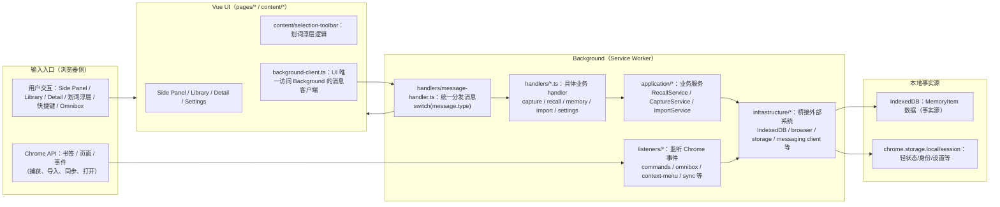
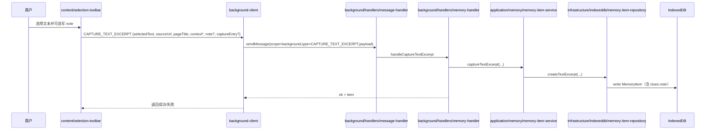
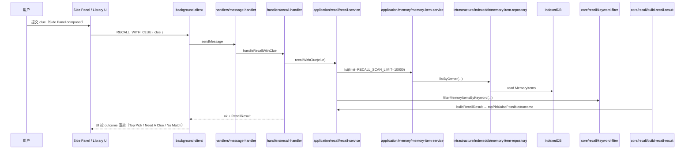
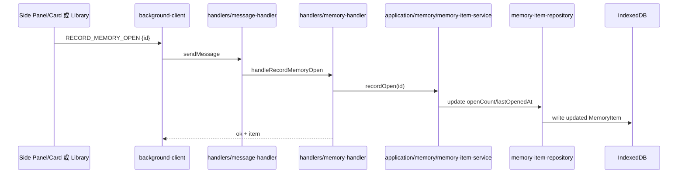
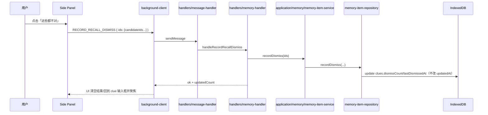

## Yiveno 运行时架构流程（最终版 v1）

面向“避免以后走弯路”的工程化梳理：把产品主链路（Capture → Recall → Open → feedback）与代码级实现链路（UI → background-client → Background handler → application/service → core → infrastructure/IndexedDB）对齐。

## 0. 权威来源与本文件边界

### 0.1 权威来源（不冲突）

- [`Yiveno-术语表.md`](../product/Yiveno-术语表.md)：概念叫法唯一权威（clue、Recall、附注、邻域等）。
- [`CURRENT.md`](../product/CURRENT.md)：当下焦点与本周 scope（新会话先读）。
- [`architecture/decisions/`](../architecture/decisions/)：不可逆架构决策（ADR）。
- `docs/product/Yiveno-产品文档-v4.0.md`：核心路线、资产/边界/隐患、找回体验规范（尤其 §0.1 / §0.1.1 / §7）。
- `.cursor/rules/project.mdc` + `AGENTS.md`：分层与代码硬约束（唯一监听者、IndexedDB 唯一入口、消息契约先于实现等）。

### 0.2 本文件覆盖范围

- 系统分层与数据流（运行时）
- 关键产品流程的运行时“端到端链路”
- 消息契约（message type / handler / background-client 映射）
- 未来新增能力时的“标准改动流程”（避免引入架构回潮）
- 对 Recall 主链路的几个产品关键不变量（Top Pick / Need A Clue / dismissCount）

### 0.3 本文件不覆盖

- 新能力的算法细节推导
- UI 细节像素级样式
- Phase B+（Hybrid / embedding / 倒排索引 / 云同步）完整接入方案（只做“预留边界提示”）

## 1. 系统全景架构图（运行时）

> 关键词：**单向数据流**、**Background 唯一监听者**、**IndexedDB 唯一事实源**。



## 2. 分层依赖与硬约束（避免走弯路）

### 2.1 分层（DDD 方向）

- `pages/* / content/*` → `application/*` → `core/*`
- `application/*` 允许依赖 `infrastructure/*`
- `core/*` 不直接依赖 Chrome API / IndexedDB

### 2.2 3 条“硬禁止”清单（务必记住）

1. **UI 不得直连 IndexedDB / `chrome.bookmarks.*` / `chrome.tabs.*` 等**  
   UI 只能通过 `frontend/src/infrastructure/messaging/background-client.ts` 发消息给 Background。
2. **Background 必须是唯一 Chrome API 监听者**  
   Chrome 事件监听/处理（例如 omnibox、commands、import 监听、badge、同步）都在 `frontend/src/background/*`。
3. **IndexedDB 唯一入口**  
   所有 IndexedDB 操作必须走 `frontend/src/infrastructure/indexeddb/manager.ts` 的 `indexedDBManager`（或其封装的 repository）。

### 2.3 4 条“改动顺序”规则（最容易走弯路的地方）

当你要新增一条业务能力（尤其涉及 Recall）时，按以下顺序改：

1. **先改消息契约**（`core/messaging/*-messages.ts`，再对齐 background 分发 union）
2. **再加 Background handler 分发**（`handlers/message-handler.ts`）
3. **再加 application/core/infrastructure 实现**
4. **最后改 UI**（通过 `background-client.ts` 调消息）

### 2.4 目录职责与依赖禁区（新代码放哪里）

为了“后续源源不断新增功能”仍能稳定演进，这里把 `frontend/src` 的关键目录职责写成可执行规则。

#### 2.4.1 `core/`（领域规则与契约）

- 放：Recall 规则（评分/折叠/结果态/解释逻辑）、Memory 数据结构与 payload/消息 schema（Zod）、可独立单测的纯逻辑函数。
- 禁：引用 `chrome.*`、引用 IndexedDB 原生 API（任何 IO 直接依赖）。
- 目的：产品体验差异优先落在 core，并保证可单测与可评测。

#### 2.4.2 `application/`（用例编排）

- 放：RecallService、Capture/Import/Settings 的业务编排（读取数据、调用 core 规则、组织输入输出）。
- 允许：依赖 `infrastructure/`。
- 禁：把外部能力“封装细节”写进 application（细节留 infrastructure）。

#### 2.4.3 `infrastructure/`（实现落地）

- 放：IndexedDB manager/repository、浏览器 API 封装、i18n/t、background-client 封装、UI 基础组件（不包含领域规则）。
- 目标：对 application/pages 提供稳定接口，且集中处理外部实现差异。

#### 2.4.4 `background/`（运行时壳：唯一 Chrome API 监听者）

- 放：listeners/_（omnibox/commands/context-menu/sync 等）+ handlers/_（message-handler switch + 各业务 handler）
- 禁：UI 直接调用 Chrome API（UI 必须通过 background-client）。
- 目标：任何“会被浏览器事件触发”的能力都归到 background。

#### 2.4.5 `offscreen/`（运行时壳：无 DOM 安全任务容器）

- 放：offscreen document 的入口与（未来）embedding/无 DOM 任务的执行框架。
- 当前状态：仅 `PING` 级别占位监听，embedding 接入前不启用主链路。

#### 2.4.6 `pages/` / `content/`（表现层）

- 放：Vue 页面与 content script 的 UI/交互状态机。
- 禁：直连 IndexedDB / chrome.bookmarks / chrome.tabs 等。
- 必须：通过 `frontend/src/infrastructure/messaging/background-client.ts` 发消息给 background。

#### 2.4.7 最小依赖方向（建议长期固定）

- `pages/content` 只能依赖 `infrastructure`（通过 background-client），不依赖 core/infrastructure 的“底层 IO 实现细节”。
- `application` 可以依赖 `infrastructure`，但不依赖 `background/offscreen`。
- `core` 只依赖类型/纯逻辑，不依赖任何运行时壳。

### 2.5 新功能放置决策树（推荐直接照做）

当你要新增一条“可被用户使用”的能力时，按下面判断顺序放文件/改代码：

1. **我在改的是“规则/排序/结果态/匹配逻辑”吗？**
   - 是 → 放 `core/`（优先写纯函数 + 单测 + 必要时 eval case）
   - 否 → 进入第 2 步
2. **我在改的是“怎么读数据、怎么调用 core、怎么串流程”吗？**
   - 是 → 放 `application/`（service 编排，必要时调用 infrastructure）
   - 否 → 进入第 3 步
3. **我在改的是“外部系统实现细节”吗？（IndexedDB/浏览器 API/i18n/消息客户端）**
   - 是 → 放 `infrastructure/`
   - 否 → 进入第 4 步
4. **我在改的是“运行时壳/事件入口”？（Chrome 事件、message 分发、offscreen 入口）**
   - 是 → 放 `background/` 或 `offscreen/`
   - 否 → 进入第 5 步
5. **我在改的是 UI 交互与展示？**
   - 是 → 放 `pages/` 或 `content/`，且只经 background-client

补充硬规则：

- 任何牵涉 UI → background 的能力：先改 `core/messaging` 契约，再补 `handlers/message-handler.ts` 分发，补 `background-client.ts` 封装，最后改 UI。
- 任何牵涉 IndexedDB：禁止 UI/core 直碰；走 repository/manager。

### 2.6 RecallBackend 扩展缝（支持完整 RecallBackend 的更干净扩展）

为避免未来接入 Hybrid/embedding/索引时在主链路到处写分支，本项目在 `application/recall` 引入“完整 RecallBackend”扩展缝：

- 新接口：`frontend/src/application/recall/recall-backend.ts`
  - 契约：`recallWithClue(clue: string): Promise<RecallResult>`
- 当前主实现：`frontend/src/application/recall/backends/keyword-recall-backend.ts`
  - 保证与旧版行为一致（关键词 Filter + 结果态构建 + `Need A Clue` / top/also/no_match 逻辑）
- 未来骨架（未启用）：`frontend/src/application/recall/backends/hybrid-recall-backend.ts`

入口在哪里接管？

- `frontend/src/application/recall/recall-service.ts`
  - `RecallService` 只做委托：`return backend.recallWithClue(clue)`
  - 当前工厂 `createRecallBackend()` 固定返回 `KeywordRecallBackend`

未来新增 backend 的标准步骤（必须照做）

1. 新建 backend 实现文件，实现 `RecallBackend`。
2. 不改 UI/handlers/core 结果态构建代码。
3. 只改 `createRecallBackend()`（或未来用设置开关切换）。
4. 如 Recall 的 outcome/排序规则有变化：补 eval case（`frontend/src/core/recall/eval/`）并确保 `must` 全绿。
5. 如候选集来源改变但结果构建仍一致：优先补“候选集→top/also/need/no_match”相关的领域单测。

## 3. 产品主流程（端到端）标准化描述

下面把“用户能感知到的动作”拆成可复用的运行时链路。

### 3.1 Capture：保存一条 MemoryItem

**触发入口**

- 划词浮层（`content/selection-toolbar`）：Capture Text Excerpt
- 右键菜单：Capture Text Excerpt（如果启用）
- Chrome 原生书签（background 监听）：Capture Bookmark（作为配角导入）

**运行时链路（Capture Text Excerpt）**



**运行时链路（Capture Bookmark）**同理，payload 走 `CAPTURE_BOOKMARK`。

### 3.2 Recall：用线索找回（关键词 Filter）

Recall 当前主链路（MVP/当前 Phase A/B 最小）是：

```text
clue → 关键词 Filter → 排序 → 折叠（duplicates）→ Top Pick / Also Possible / Need A Clue / No Match
```

当“最佳候选得分未达阈值”时触发 `Need A Clue`。

**Recall 端到端链路（以 Side Panel 为例）**



### 3.3 Open：打开结果页并写行为信号（openCount / lastOpenedAt）

**原则**

- 打开行为由 UI 触发导航
- 同时通过 background-client 写入 `RECORD_MEMORY_OPEN`



> 注意：若打开的是 `detail.html`，详情页写「线索/行为/计数」的细节由各自页面负责（以现有实现为准），不要在 Side Panel 重复计数。

### 3.4 Feedback：Need A Clue & dismiss（“这些都不对”）

**用户动作**

- 在 `Need A Clue` 或结果页点击「这些都不对」

**反馈写回逻辑**

- 写入 `dismissCount += 1`
- 写入 `lastDismissedAt = now`
- 不改 `updatedAt`（确保 repository 的语义不混乱）



**排序影响（核心不变量）**

- `keyword-filter.ts` 中 `computeDismissPenalty(item)` 计算惩罚
- 惩罚在 `scoreMemoryItem` 中用于 `score -= penalty`

因此 dismiss 是“在同一线索下让被否定项更难再上位”的闭环。

### 3.5 Omnibox 单次 Recall（无追问会话）

Omnibox 是“单次命中”入口：输入变化只生成原生建议，不做会话追问；回车确认只跑一轮 Recall 并打开 Top 命中。

**关键点（产品边界）**

- 无追问会话（不复用 Side Panel 的 Need A Clue 多轮交互态）
- 避免落进“placeholder URL 后忘记记录/跳转”的状态：书签通过 `recordMemoryOpen` 写行为信号；摘录进 `detail.html` 由详情页记录

**代码链路（Background listener 内部直跑，无 UI messaging）**

- `frontend/src/background/listeners/omnibox.ts`
  - `registerOmniboxListeners()`
    - `onInputChanged`：`recallService.recallWithClue(clue)` → `recallResultToOmniboxSuggests(...)` → `chrome.omnibox.suggest(...)`
  - `onInputEntered`
    - 若是 `omnibox-open.html?id=...` 占位建议：先 `recordOpenBestEffort(memoryItemId)`，再读 `memoryItemService.getById` 并解析目标 URL，最后按 `disposition` 打开
    - 若是直接 URL：直接打开
    - 若是纯线索：再跑一轮 `recallService.recallWithClue(clue)`，取 `result.topPick` 的 `getMemoryItemOpenHref` 并打开
      - 若 `topPick.item.type === 'bookmark'`：此处记录 `recordMemoryOpen`
      - 若是 `text_excerpt`：打开的是 `detail.html?id=...`，行为计数由 `Detail.vue` 记录

### 3.6 快捷键命令入口（开壳/激活功能）

用户的「打开 Recall Side Panel / 打开记忆库 / 打开设置 / 保存选区」主要通过两层完成：

1. **Chrome 工具栏 action + `sidePanel.openPanelOnActionClick`**：无 `default_popup`；点击图标打开 Side Panel（`ensureSidePanelOpensOnActionClick`）
2. **Yiveno 自定义 commands**：由 Background 注册后执行对应动作（`open_recall` 等经 `handleOpenRecallShell`）

**代码链路**

- `frontend/src/background/listeners/commands.ts`
  - `registerCommandListeners()`
    - `open_library` → `focusOrOpenLibraryTab()`
    - `open_settings` → `focusOrOpenSettingsTab()`
    - `save_selection` / `save_selection_with_note`
      - 通过 `dispatchSelectionToolbarCommand(...)` 让划词脚本执行保存/写附注

- `frontend/src/core/ui/keyboard-command.ts`
  - 只负责“解释键盘意图”（上/下/Enter confirm 等）
  - 具体页面把意图映射到自己的状态机（比如 Side Panel 的结果列表键盘导航）

### 3.7 Library / Detail 打开链路（行为记录落点）

为了避免重复计数，行为记录的“落点”由页面负责：

**Library：**

- `frontend/src/pages/library/Library.vue`
  - 加载摘录列表：`background-client.listMemoryItems({ type: 'text_excerpt', limit: ... })`
  - 加载书签树：`background-client.fetchBookmarkLibraryTree()`
  - 打开书签（含 `memoryItemId`）时会先写 `recordMemoryOpen({id})`，再执行 `window.open(url, ...)`

**Detail：**

- `frontend/src/pages/detail/Detail.vue`
  - 读取 `id`：`background-client.getMemoryItem({id})`
  - 若 `item.type === 'text_excerpt'`：
    - `viewState = 'ready'`
    - `recordMemoryOpen({ id })` 写入行为信号
  - 若是 `bookmark`：
    - Detail 不走 `recordMemoryOpen`（只展示“打开书签”链接），行为由 Library/Omnibox/其他打开点负责

## 4. 代码级架构流程（把路径写清楚）

为了避免以后“改着改着串层”，这里给一个严格映射：你在改哪一类需求时，应该先看哪个文件。

### 4.1 消息契约（Message Schema）

- `frontend/src/core/messaging/background-messages.ts`  
  统一导出 Background scope 消息 union（只做类型/契约，不做业务）。
- `frontend/src/core/messaging/memory-messages.ts`  
  `CAPTURE_BOOKMARK` / `CAPTURE_TEXT_EXCERPT` / `LIST_MEMORY_ITEMS` / `GET_MEMORY_ITEM` / `DELETE_MEMORY_ITEM` / `UPDATE_MEMORY_NOTE` / `RECORD_MEMORY_OPEN` / `RECORD_RECALL_DISMISS`
- `frontend/src/core/messaging/recall-messages.ts`  
  `RECALL_WITH_CLUE`

### 4.2 Background 分发（switch）

- `frontend/src/background/handlers/message-handler.ts`
  - `dispatchBackgroundMessage(message)`：按 `message.type` 调具体 handler

你要新增 message type 时，**先更新 core messaging 契约**，再把 switch 分发补齐。

### 4.3 Background handlers（业务入口）

- Recall：
  - `frontend/src/background/handlers/recall-handler.ts`
    - `handleRecallWithClue(payload)` → 调用 `recallService.recallWithClue`
- Memory：
  - `frontend/src/background/handlers/memory-handler.ts`
    - `handleCaptureBookmark`
    - `handleCaptureTextExcerpt`
    - `handleListMemoryItems`
    - `handleGetMemoryItem`
    - `handleDeleteMemoryItem`
    - `handleUpdateMemoryNote`
    - `handleRecordMemoryOpen`
    - `handleRecordRecallDismiss`

### 4.4 application：业务服务（编排）

- `frontend/src/application/recall/recall-service.ts`
  - `RECALL_SCAN_LIMIT ≈ 10000`
  - `memoryItemService.list({limit})`
  - `recallByKeyword(items, clue, { candidateLimit: 6 })`

- `frontend/src/application/memory/memory-item-service.ts`
  - 写 openCount/lastOpenedAt
  - 写 dismissCount/lastDismissedAt
  - 通过 repository 实现持久化

### 4.5 core：领域规则（可测试、可评测）

- Recall 结果构建：
  - `frontend/src/core/recall/build-recall-result.ts`
    - `best.score < RECALL_TOP_PICK_MIN_SCORE` → `need_a_clue`
    - `outcome` 的分支逻辑与弱候选规则都在这里
- 关键词 Filter：
  - `frontend/src/core/recall/keyword-filter.ts`
    - `filterMemoryItemsByKeyword`
    - `scoreMemoryItem`
    - `computeDismissPenalty`
- duplicates 折叠互斥：
  - `frontend/src/core/recall/collapse-recall-duplicates.ts`

### 4.6 infrastructure：IndexedDB 与外部桥接

- `frontend/src/infrastructure/indexeddb/manager.ts`
  - `indexedDBManager`：唯一 IndexedDB 初始化/事务入口
- `frontend/src/infrastructure/indexeddb/memory-item-repository.ts`
  - `recordDismiss(ids)`：递增 `dismissCount`，写 `lastDismissedAt`，不改 `updatedAt`
  - create/list/get/update/softDelete 等持久化

## 5. 消息契约总表（UI/Client ↔ Background handler）

> 这张表是“新增消息/新增能力时”的对照表：不要跨层绕路。

| 功能                  | UI 调用（background-client） | Background handler            | 领域/服务                                            | IndexedDB 写回                            |
| --------------------- | ---------------------------- | ----------------------------- | ---------------------------------------------------- | ----------------------------------------- |
| Recall（关键词找回）  | `recallWithClue()`           | `handleRecallWithClue()`      | `application/recall/recall-service.ts` + core recall | 读 `MemoryItem`（按 `RECALL_SCAN_LIMIT`） |
| Need A Clue / dismiss | `recordRecallDismiss()`      | `handleRecordRecallDismiss()` | `memoryItemService.recordDismiss`                    | 写 `dismissCount`/`lastDismissedAt`       |
| 打开结果行为          | `recordMemoryOpen()`         | `handleRecordMemoryOpen()`    | `memoryItemService.recordOpen`                       | 写 `openCount`/`lastOpenedAt`             |
| 列出记忆库            | `listMemoryItems()`          | `handleListMemoryItems()`     | `memoryItemService.list()`                           | 读 MemoryItems                            |
| 读取详情              | `getMemoryItem()`            | `handleGetMemoryItem()`       | `memoryItemService.getById()`                        | 读 MemoryItem                             |
| 附注更新              | `updateMemoryNote()`         | `handleUpdateMemoryNote()`    | `memoryItemService.updateNote()`                     | 写 `clues.note`                           |
| 捕获（摘录）          | `CAPTURE_TEXT_EXCERPT`       | `handleCaptureTextExcerpt()`  | `memoryItemService.captureTextExcerpt()`             | 写 MemoryItem                             |
| 捕获（书签）          | `CAPTURE_BOOKMARK`           | `handleCaptureBookmark()`     | `memoryItemService.captureBookmark()`                | 写 MemoryItem                             |
| 删除摘录              | `deleteMemoryItem()`         | `handleDeleteMemoryItem()`    | `memoryItemService.softDelete()`                     | 软删 `text_excerpt`                       |

> background-client 的函数定义在：`frontend/src/infrastructure/messaging/background-client.ts`

## 6. Recall 产品不变量（修改算法时必看）

为了“避免以后走弯路”，下面把 Recall 的产品约束固化为不变量（改变它意味着产品体验会变）。

### 6.1 Top Pick vs Need A Clue

- `frontend/src/core/recall/build-recall-result.ts`
  - 若 best.score < `RECALL_TOP_PICK_MIN_SCORE (18)`：`outcome = 'need_a_clue'`
  - `topPick = null`
  - `alsoPossible` 只放弱候选

### 6.2 dismiss 只做否定反馈，不做“重排序功能外推”

- `RECORD_RECALL_DISMISS` 只更新 clues.dismissCount/lastDismissedAt
- `scoreMemoryItem` 中惩罚项来自 `computeDismissPenalty`（log2 封顶）

### 6.3 探活扫描上限

- `frontend/src/application/recall/recall-service.ts`
  - `RECALL_SCAN_LIMIT = 10000`

当前阶段不要在 UI 或 core 随意改扫描策略；如需改，必须同步：

- `recall-eval` 的基线
- 性能实测（尤其 Side Panel / Omnibox 的延迟）

## 7. 测试与评测：怎么用来“避免回归”

### 7.1 必保门禁（CI）

- `frontend/src/core/recall/eval/recall-eval.test.ts`
  - `must 门禁必须全通过`
  - `stretch 用例给进度，不挡门禁`

### 7.2 领域单测

- `keyword-filter.test.ts`：tokenize、score、dismissPenalty 等
- `build-recall-result.test.ts`：need_a_clue 与 top/also 互斥规则
- `collapse-recall-duplicates.test.ts`：duplicates key、互斥规则

### 7.3 message/handler 集成

- `frontend/src/background/handlers/memory-handler.test.ts`
- `frontend/src/background/handlers/recall-handler.test.ts`

### 7.4 新能力新增测试的最低标准（建议）

新增能力若影响 Recall 排序/结果态：

- 必须补 eval case（至少 must 或 stretch）
- 必须补 1 条 dismiss/feedback 相关断言（若触及 feedback 闭环）
- 必须补 1 条 handler 或 repository 写回断言（确认数据确实落盘）

## 8. 未来新增能力时的“标准改动流程”（强烈建议照做）

当你想增加一条 Recall 相关能力（例如：新增过滤条件、改变 outcome 分支、增加新的反馈写回）：

1. **先明确：属于 core 规则还是 application 编排？**
   - core：决定 outcome/排序/惩罚/折叠互斥
   - application：决定“取多少数据/调用哪些服务/是否 join”
2. **先改 core，再改 application**（不要先改 UI）
3. **再改消息契约**（若涉及 UI 触发）
   - 先 `core/messaging/*-messages.ts`
   - 再补 `background/handlers/message-handler.ts` switch
   - 再补 `infrastructure/messaging/background-client.ts`
4. **最后改 UI**（在 `pages/*` 或 `content/*` 使用 background-client）
5. **同步测试**
   - eval case（影响 Recall 就必须）
   - repository/handler 写回（影响数据就必须）
   - 单测覆盖关键分支（Top/Need/NoMatch/dismiss）

## 9. 常见走弯路清单（建议长期贴着看）

1. 在 UI 里直接调 `indexedDB.open` / `chrome.tabs.*` / `chrome.bookmarks.*`。
2. 在 core 里引入 Chrome API 或 IndexedDB（破坏可测试性）。
3. 随意新增 message type，但忘记：
   - `core/messaging/*` 契约
   - `background/handlers/message-handler.ts` 分发
   - `background-client.ts` 封装
   - UI 侧类型对齐
4. 改动 Recall outcome 分支（Top/Need/NoMatch）但 eval 没同步更新。
5. 修改 dismiss 语义（例如改 updatedAt）但 repository/评分侧没有保持一致。

---

## 附录 A：关键路径快速索引（方便你在实现时直达）

- 消息契约：
  - `frontend/src/core/messaging/memory-messages.ts`
  - `frontend/src/core/messaging/recall-messages.ts`
  - `frontend/src/core/messaging/background-messages.ts`
- Background 分发：
  - `frontend/src/background/handlers/message-handler.ts`
- Background handlers：
  - `frontend/src/background/handlers/memory-handler.ts`
  - `frontend/src/background/handlers/recall-handler.ts`
- application：
  - `frontend/src/application/memory/memory-item-service.ts`
  - `frontend/src/application/recall/recall-service.ts`
- core：
  - `frontend/src/core/recall/build-recall-result.ts`
  - `frontend/src/core/recall/keyword-filter.ts`
  - `frontend/src/core/recall/collapse-recall-duplicates.ts`
- infrastructure：
  - `frontend/src/infrastructure/indexeddb/manager.ts`
  - `frontend/src/infrastructure/indexeddb/memory-item-repository.ts`
- UI 消息客户端：
  - `frontend/src/infrastructure/messaging/background-client.ts`
- UI 主入口：
  - `frontend/src/pages/sidepanel/SidePanel.vue`
  - `frontend/src/pages/library/Library.vue`
  - `frontend/src/pages/detail/Detail.vue`
  - `frontend/src/content/selection-toolbar/main.ts`
