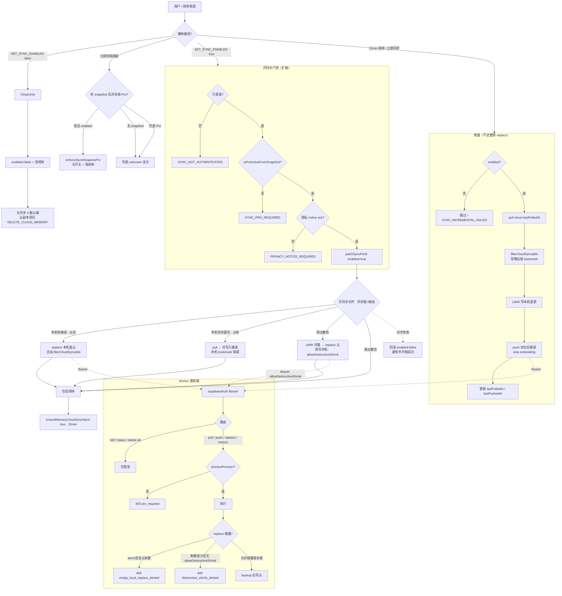

# ADR-017: 云同步范围 = 摘录；书签 Memory 本机化

- **状态：** 已接受
- **日期：** 2026-10-14
- **决策者：** 产品 Normative

## 背景

云同步对 Yiveno **仍有价值**（换机带走登录后积累的私有痕迹），但「同步什么」不可含糊。

现行实现按 `MemoryItem` **全类型** push/pull（`selectMemoryItemsToPush` 无 type 过滤），会把 **Chrome 灌库书签** 也送上云并在设备间并集。问题：

1. **Chrome 书签本身已有（或可有）Chrome 同步**；各设备书签集本就可不同。
2. Yiveno 再做书签壳的跨设备并集 = **第三真相源**，文件夹/删留/重复 URL / `chromeBookmarkId` 跨 Profile 不可比 → 复杂度与误伤风险高。
3. 产品资产表已钉：`text_excerpt` = 主角与终局壁垒；`bookmark` = day-0 配角库存（§0.1.1）。云侧应对齐**账号产生的私有增量**，而非重做书签管理器。

## 决定

1. **云同步可感范围（Normative）= 仅 `text_excerpt`。**  
   Pro + 登录 + 开关仍成立；上云/拉回的工作集只含摘录（含其 `clues.*` / 软删标记等条目字段；embedding 仍按既有规则剥离或不入同步载荷）。
2. **`bookmark` MemoryItem 不上云、不因云同步写入本机。**  
   各设备书签壳仅来自**该机** Chrome 灌库 / 本机第三方导入；换机靠该机再授权灌库，**不**经 Yiveno 云合并书签林。
3. **书签上的 `clues.note`（附注）：** 当前随 bookmark 条目存本机；本 ADR **不**单独上云。若日后要跨设备附注，须另开「按 URL（或稳定键）附着的附注层」方案，**禁止**借整棵书签 Memory 上云偷渡。
4. **遗留云端 bookmark 行：** 出站 replace / 合并盖云时允许按新范围缩量（可 `allowDestructiveShrink`），摘除云端历史 bookmark；本机既有书签**不**因本策略被删。增量 pull **忽略**远程 `bookmark`。
5. **Backup 整库导出**仍含当前 owner 全部类型（含书签）——本机主权导出 ≠ 云同步范围。

## 后果

**必须：**

- 产品文档 §5.x 云同步 Normative 写明类型范围；Settings / 隐私文案不得再暗示「书签也会上云同步」。
- 扩展：push / 增量 pull / 开同步合并出站 / 本机盖云出站 一律经 `isCloudSyncableMemoryItem`（仅 `text_excerpt`）。
- 换机叙事：摘录跟账号走；书签跟「这台 Chrome 已灌库」走。

**禁止：**

- 用云同步并集「整合」多设备 Chrome 书签树。
- 为过换机 demo 把 bookmark 重新划进默认同步面而不改本 ADR。
- 把「不上云」写成「本机不该有书签 Memory」——本机灌库 / Recall 书签仍成立。

## 拒绝的替代

| 方案                          | 为何不选                                 |
| ----------------------------- | ---------------------------------------- |
| 关掉全部云同步                | 摘录跨设备仍有清晰账号价值；过冲         |
| 仅同步「带 note 的书签」      | 仍绑 `chromeBookmarkId` / 壳合并，半吊子 |
| 云同步书签但禁止反向写 Chrome | 仍有双设备 Yiveno 书签并集冲突，未减风险 |

## 门禁与主链（图表）

> **范围：** Pro + 登录 + 开关 → 仅 `text_excerpt` 上云/拉回；开同步对齐；15 分钟增量；replace 缩量 409。  
> **不含：** Dodo webhook→Pro 投影细节（盘点 P2-1）；书签 Chrome→IDB 灌库；Auth mint/handoff；删账号 / 整库导出全时序。  
> **权威行为：** 产品文档 §账户与同步 / 隐私 Normative；本 ADR 钉类型范围。  
> **报告：** [`docs/diagrams/reports/2026-10-Pro-Cloud-Sync图表补齐.md`](../../diagrams/reports/2026-10-Pro-Cloud-Sync图表补齐.md)

**三门禁（Normative · 代码双端）：** 登录（`AccountBinding` + Bearer）· 有效 Pro（扩展本机 snapshot 开同步前拦；Worker `denyUnlessActivePro` 拦 pull/push/replace/restore）· `syncPrefs.enabled`（`chrome.storage.local` · 默认 false）。`GET /status` 与隐私删云 `delete-all` **仅需登录**（可不 Pro）。

<!-- diagram: id=sync.excerpt-cloud-pro-gate kind=flowchart status=implemented -->

**刻意折叠：** Dodo 投影链路；退出 flush_then_keep 整侧盖云旁路；restore-latest-backup 条数最多快照细节；孤儿桶 remap 内部。

## 相关

- 产品文档 §0.1.1 资产表；§5 账户与同步 / 隐私
- ADR-012（私有增量壁垒）；ADR-004（数据平面确定性）
- 图表 registry：`sync.excerpt-cloud-pro-gate`
