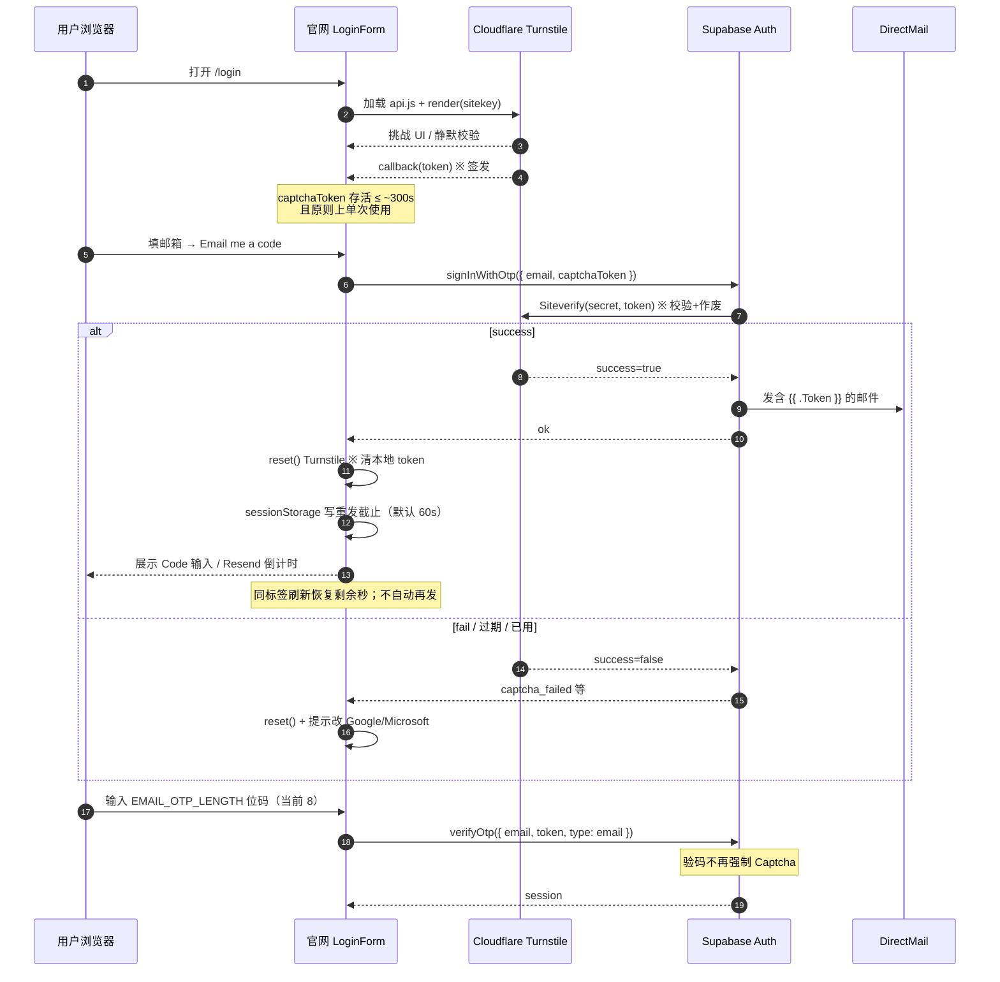
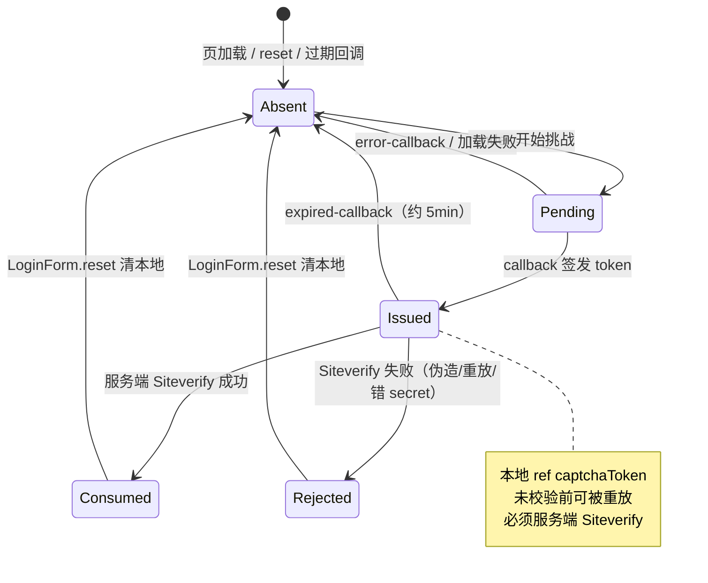
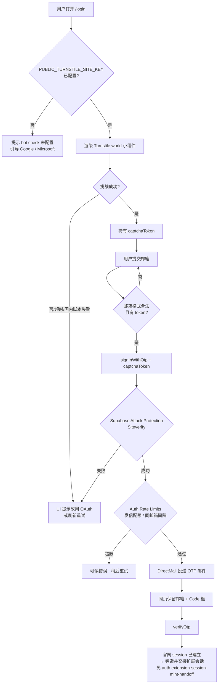
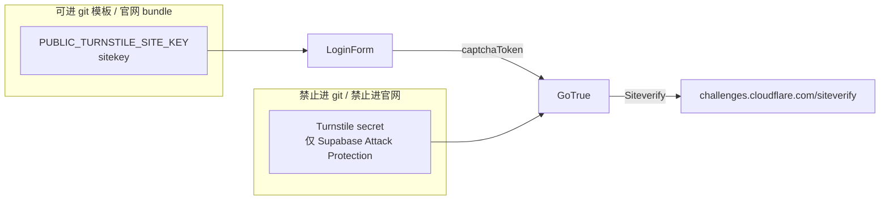
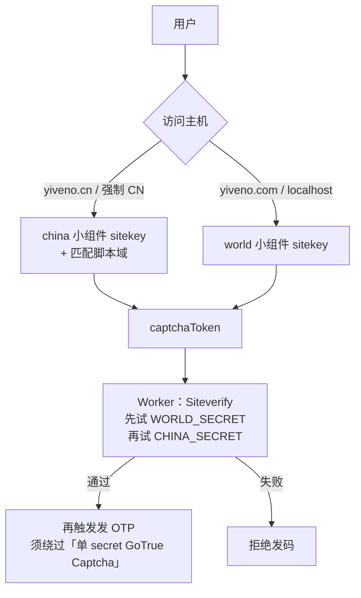

# Turnstile · Email OTP 防刷生命周期与流程图

> 开发者资料（非产品 UI 文案）。说明官网「邮件验证码登录」如何与 Cloudflare Turnstile、Supabase Auth 串起来，以及 **国内可达 / china 区域** 的约束与后续路径。  
> **用词：** Turnstile = Cloudflare 人机验证产品；`captchaToken` = 小组件发给官网的一次性证明；**Siteverify** = Cloudflare 服务端校验并作废该 token 的接口（业内产品 API 名，可保留）。

## 1. 角色一览

| 角色                 | 是什么                         | 手里有什么                                                     |
| -------------------- | ------------------------------ | -------------------------------------------------------------- |
| **Turnstile 小组件** | Cloudflare 账号级 bot 挑战实例 | **sitekey**（公开）+ **secret**（保密）；`region` 创建后不可改 |
| **官网 `/login`**    | 渲染部件、拿 token、调发码     | 仅 sitekey（`PUBLIC_TURNSTILE_SITE_KEY`）                      |
| **Supabase GoTrue**  | 校验 token 后才发 OTP 邮件     | Dashboard 里配置的 **单个** Turnstile secret                   |
| **DirectMail SMTP**  | 真正投递邮件                   | 与 Captcha 无关；Captcha 管「谁配发」                          |

当前生产小组件（world）：

| 项      | 值                                                                                              |
| ------- | ----------------------------------------------------------------------------------------------- |
| 名称    | `yiveno-login`                                                                                  |
| sitekey | `0x4AAAAAADQljXtogaNU8cqP`                                                                      |
| region  | `world`（默认）                                                                                 |
| 主机名  | `localhost` · `yiveno.com` · `www.yiveno.com` · `yiveno.cn` · `www.yiveno.cn`                   |
| 模式    | Managed（托管）+ 客户端 `appearance: interaction-only`（默认不露 Success 条；高风险才可见挑战） |

---

## 2. `captchaToken` 生命周期

**读图小词：** **sitekey** = 公开的小组件 ID（可进前端）；**secret** = 仅服务端校验用（禁止进 git/官网）；**签发** = Turnstile 回调给出 token；**Siteverify** = Cloudflare 校验并作废 token；**reset** = 官网清本地 token 并重渲小组件。

<!-- diagram: id=turnstile.captcha-token-lifecycle kind=sequence status=implemented -->

### 状态机（token）

**读图小词（相对上节生命周期）：** 本图只描述**官网本地** `captchaToken` 状态，**不含**邮箱 OTP 验码。**Absent** = 无本地 token；**Pending** = 小组件挑战进行中；**Issued** = 已签发、尚未经服务端作废（可被重放，故必须 Siteverify）；**Consumed** = Siteverify 成功、token 已作废；**Rejected** = Siteverify 失败；各路失败/过期/reset 均回 Absent。

<!-- diagram: id=turnstile.captcha-token-state kind=state status=implemented -->

---

## 3. 端到端流程图（含配额层）

**读图小词：** 本图止于**官网 session**；末端「铸造并交接」见 `auth.extension-session-mint-handoff`（AUTH_GUIDE）。**Attack Protection** = Supabase 控制台人机验证开关；**Auth Rate Limits** = 发信配额/同邮箱间隔（业内限流，非 Turnstile）。

<!-- diagram: id=turnstile.email-otp-e2e kind=flowchart status=implemented -->

三层分工：

| 层               | 挡什么                          |
| ---------------- | ------------------------------- |
| Turnstile        | 无头浏览器 / 批量脚本过发码入口 |
| Auth Rate Limits | 真人/半自动刷爆发信             |
| SMTP 配额        | 阿里云侧硬顶                    |

---

## 4. 密钥与环境（勿混）

**读图小词：** 左公开、右机密；GoTrue = Supabase Auth 服务；二者只在**服务端 Siteverify** 相遇。

<!-- diagram: id=turnstile.secrets-split kind=flowchart status=implemented -->

| 环境             | sitekey 去向                                                                                       |
| ---------------- | -------------------------------------------------------------------------------------------------- |
| 本机             | `.env.shared.local` → `bun run env:sync:dev` → `website/.env`                                      |
| Cloudflare Pages | `yiveno-website` production/preview 环境变量 `PUBLIC_TURNSTILE_SITE_KEY`（**下次部署**才进静态包） |

---

## 5. 国内访问与 `region: china`（决策与现状）

### 5.1 问题

`world` 小组件脚本与挑战走 `challenges.cloudflare.com`。部分国内网络慢、超时或失败 → 用户无法拿到 `captchaToken`，Email OTP 入口不可用（OAuth 亦常不可用，故体验更痛）。

### 5.2 Cloudflare 能力

- API 允许创建时设 `region: "world" | "china"`，**创建后不可改**。
- **china 与 world 是两套独立小组件** → **各自 sitekey + secret**。
- 客户端错误码 `400021`：sitekey 的 region 须与脚本标签域名匹配（china 部件不能只挂 world 脚本域乱绑）。

### 5.3 硬约束（本仓）

1. **Supabase Attack Protection 只支持配置一个 Captcha secret。**  
   china token 无法用 world secret 校验，反之亦然。双区域同时服务 **不能** 只靠「Dashboard 填一个 secret」。
2. **当前 Cloudflare 账号 Dashboard「添加小组件」表单无 Region / 中国 选项**；MCP API token **无** `challenge-widgets.write`，无法 API 创建。  
   → **截至本文 `updated`：未能在本账号落地 `yiveno-login-china`（region=china）。** 疑需 Enterprise Turnstile / 账号能力开通后再建。
3. 即便建出 china 小组件，完整双区域还须 **Worker 双 secret Siteverify**（或关闭 GoTrue 内建 Captcha、改 Admin 发码），否则 `.cn` 与 `.com` 会互斥。

### 5.4 目标架构（未接线 · 待账号能力）

> **status=planned**：下图**不是**现行路径；china 小组件与 Worker 双 secret 均未接线。

**读图小词：** **china / world** = Turnstile 创建时选定的区域（不可改）；两套 sitekey+secret；单 secret 的 GoTrue Captcha **无法**同时服务双区域。

<!-- diagram: id=turnstile.china-dual-region-target kind=flowchart status=planned -->

**在 china 小组件可用之前的务实策略（现行）：**

- 继续 **单 world 小组件** + Supabase 单 secret（已开）。
- 挑战失败：LoginForm 明确提示改用 Google / Microsoft（海外可达时）或刷新重试。
- 主机名已含 `.cn`，geo 软跳到 `yiveno.cn` 后仍用同一 world 部件（可达性不保证改善，但配置一致）。
- 账号具备 china 能力后：按 §5.4 建 `yiveno-login-china`、补 `PUBLIC_TURNSTILE_SITE_KEY_CHINA`、Worker 双验，再改 Normative。

### 5.5 开通 china 后运维检查清单

- [ ] Dashboard / API 创建 `region: china`，主机名至少含 `yiveno.cn` / `www.yiveno.cn` /（按需）`localhost`
- [ ] 记下 china **sitekey + secret**；secret **不进** `.env.shared.local` 明文仓（进 Worker Secret / 密码器）
- [ ] 客户端按主机名选 sitekey + 正确脚本源
- [ ] **不要**只把 china secret 填进 Supabase 而 `.com` 仍用 world sitekey
- [ ] 落地 Worker 双 Siteverify（或等价），再 MCP：`.cn` 与 `.com` 各抽测发码一次

---

## 6. 相关代码与文档

| 路径                                   | 职责                                      |
| -------------------------------------- | ----------------------------------------- |
| `website/src/services/turnstile.ts`    | 加载脚本、render、reset                   |
| `website/src/components/LoginForm.vue` | 发码/重发门禁、失败文案                   |
| `website/src/services/auth.ts`         | `signInWithOtp(..., captchaToken)`        |
| `docs/AUTH_GUIDE.md`                   | 运维步骤（Captcha 必开）                  |
| `docs/ENVIRONMENT.md`                  | `PUBLIC_TURNSTILE_SITE_KEY`               |
| `docs/diagrams/registry.json`          | 本文 5 张 Mermaid 图登记（`turnstile.*`） |

同步：`bun run docs:sync-diagrams --id turnstile.captcha-token-lifecycle`（或整域审阅 Brief）。

---

## 7. 修订

| 日期       | 说明                                                                              |
| ---------- | --------------------------------------------------------------------------------- |
| 2026-10-30 | 接入 diagrams registry 锚点；对照 LoginForm/turnstile/auth 试点同步（无逻辑改图） |
| 2026-10-27 | 首版：生命周期 / 流程图 / 密钥分工；记录 china 区域未落地原因与目标双验架构       |
