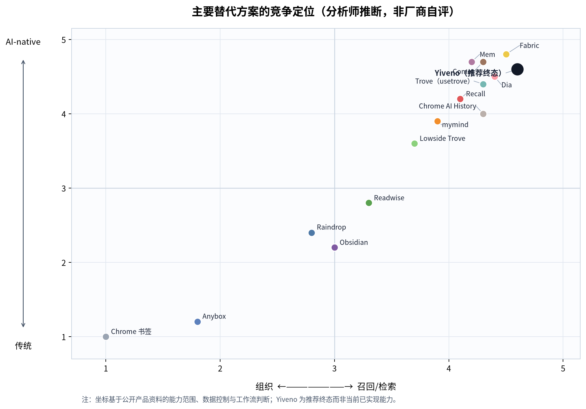
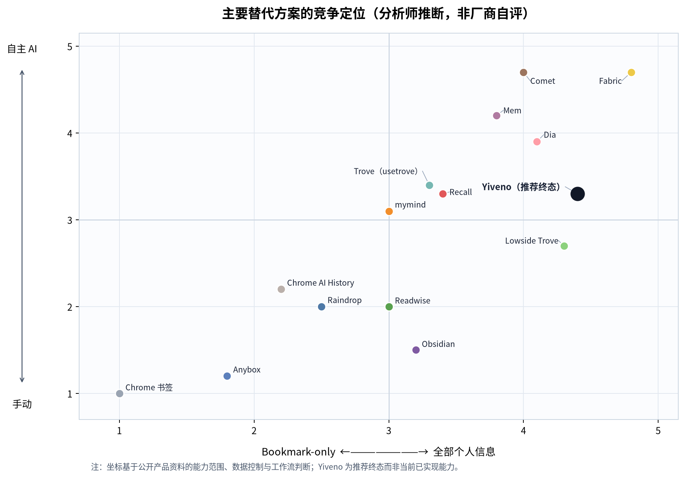
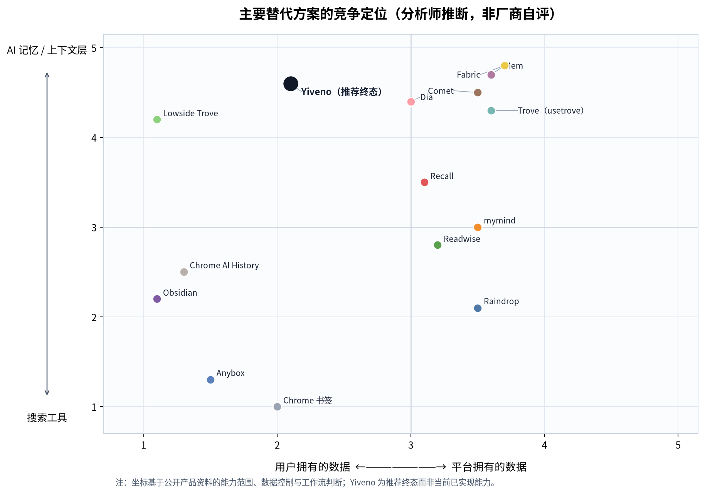
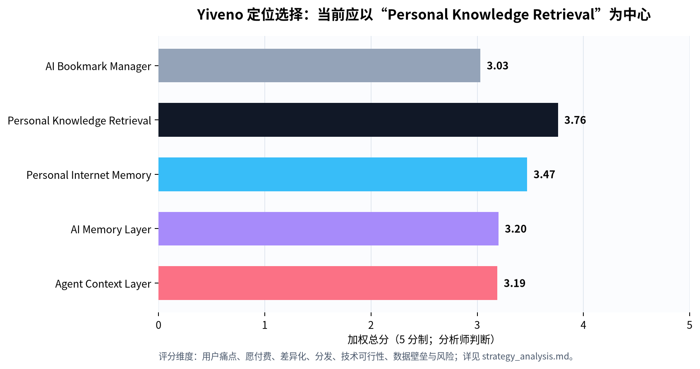

# Yiveno 市场与竞品深度研究报告

> **主题：**个人信息检索、互联网记忆与 Agent 上下文层  
> **研究日期：**2026 年 8 月 23 日（GMT+8）  
> **作者：**Manus AI  
> **研究性质：**基于公开资料的一手证据研究；未访问任何竞品后台、未购买付费套餐，也未将搜索摘要作为关键事实的唯一依据。  
> **Yiveno 术语：** 见 [`docs/product/Yiveno-术语表.md`](../docs/product/Yiveno-术语表.md)（用户输入 = **clue**；竞品 workflow 中的 query/搜索为第三方惯用语）。

## 执行摘要

Yiveno 不应把自己定义为“带 AI 的书签管理器”。该位置已经被 Raindrop.io 的跨端归档和全文检索、Readwise Reader 的阅读—标注—复习闭环、mymind 的免组织与视觉检索、Recall 的知识图谱与多模型问答所覆盖；浏览器与模型平台也在把历史、标签页、连接应用与长期记忆直接纳入默认体验。[4] [8] [12] [40] [29] [33]

更有胜算的当期定位是 **Personal Knowledge Retrieval（个人知识召回）**：用户主动保存的互联网资料，无论来自网页、PDF、视频、社交收藏或代码资源，都能在数周或数月后按内容、来源、时间、项目和行为线索被可靠找回，并能以原文证据交给任意 AI。长期可以演化为 **User-authorized Context Layer for AI（用户授权的 AI 上下文层）**，但前提是先证明“找得对、说得清、可撤销”。

本研究最重要的结论如下：

| 结论                                               | 产品含义                                                                                                   |
| -------------------------------------------------- | ---------------------------------------------------------------------------------------------------------- |
| **“保存”已经商品化；“验证式召回”仍有机会。**       | MVP 必须交付来源、原文片段、保存时间和命中理由；不能只给一段 AI 答案。                                     |
| **浏览器会吞噬单浏览器历史搜索。**                 | 不争夺 Chrome/Comet/Dia 的标签页或历史入口；做跨来源、跨浏览器、可导出的资料层。                           |
| **用户拥有和隐私是入场券，不是充分差异化。**       | 要同时提供透明导出、源级删除、最小权限、可选本地缓存，以及比本地文件夹更好的检索质量。                     |
| **主动 Agent 不应先于可靠 retrieval。**            | 先提供只读 evidence pack 与 MCP；延后发信、下单、改网页等高权限行动。                                      |
| **首发客群应是跨来源网络研究者，而非泛书签用户。** | 以独立研究者、创作者、产品/设计人员、开发者和研究生为种子用户；用真实“我以前见过”的任务衡量 top-3 找回率。 |

## 1. 研究范围、方法与证据边界

研究把市场界定为：**以个人主动保存或明确授权导入的互联网资料为对象，支持长期保存、再发现、证据回链与 AI 可调用的个人信息检索产品。** 这比传统 Bookmark Manager 更宽，但比“把邮箱、日历、私信、整个硬盘都交给 AI”的全域个人助理更窄。

本报告优先使用官方产品页、帮助文档、官方定价页、官方应用商店页、GitHub README 和 Chrome Web Store；用户反馈仅把 App Store 的公开评价作为有限样本。所有市场、用户与商业化推断均明确标识为分析判断。特别是，第三方市场报告所说的企业知识管理软件市场不是 Yiveno 的 TAM，只能作为相邻支出池和趋势参考。[43]

| 证据等级          | 本报告的使用方式                                           | 例子                                                 |
| ----------------- | ---------------------------------------------------------- | ---------------------------------------------------- |
| 一手产品/技术资料 | 确认已公开的功能、范围、定价和架构声明                     | 产品官网、定价页、帮助中心、GitHub README。          |
| 原始用户评价      | 用于理解使用动机、可靠性问题和付费摩擦；不外推为全量满意度 | App Store 的 Raindrop、Anybox、mymind、Reader 页面。 |
| 公开市场报告      | 仅作为相邻市场趋势代理，说明其定义局限                     | Grand View Research 的企业 KM 软件报告。             |
| 分析推断          | 用于定位、路线图、评分、坐标图和商业建议；不当作外部事实   | 本报告的竞争图、MVP 与定价策略。                     |

## 2. 市场不是“书签”，而是五层个人信息再利用栈

个人收藏产品正在沿着“存起来”到“找回来”再到“给 AI 用”的路径上移。书签工具仍然解决最基础的保存与整理；读后感和知识工具将网页内容转为可读、可标注、可复习的资料；AI-native 产品则试图取消人工组织；而浏览器、模型平台和 Agent 把这些资料变成连续上下文或行动依据。

| 层级                    | 代表方案                                    | 用户主要任务                                  | 现有强者           | 对 Yiveno 的意义                          |
| ----------------------- | ------------------------------------------- | --------------------------------------------- | ------------------ | ----------------------------------------- |
| L1：书签卫生            | Chrome Bookmarks、Anybox、Trove Chrome 扩展 | 保存、分组、去重、备份                        | 原生浏览器、Anybox | 必须兼容；不能停在 folder/tag。           |
| L2：阅读与归档          | Raindrop、Readwise Reader                   | 保存正文、离线阅读、标注、全文查找            | Raindrop、Reader   | 是短期最直接的替代集合。                  |
| L3：无感个人知识        | mymind、Recall、Capacities                  | 自动分类、关联、联想再发现                    | mymind、Recall     | “无组织”已非空白定位。                    |
| L4：个人上下文 / Agent  | Mem、Fabric、Trove Beta、Lowside Trove      | 让 AI 检索个人资料、保持任务上下文            | Mem、Fabric        | 是中长期形态；要靠可靠来源层进入。        |
| L5：浏览器/平台原生记忆 | Chrome、Dia、Comet、ChatGPT、Claude、Gemini | 让历史、标签页、聊天和已连接应用参与搜索/行动 | 浏览器和模型平台   | 最大捆绑威胁；Yiveno 必须 model-neutral。 |

相邻的企业知识管理软件市场被估计为 2024 年 **$20.1B**，2026 年 **$25.0B**，2033 年 **$62.2B**，但报告包括软件、服务、企业部署、组织规模和多个行业，因此不能直接切分成个人信息检索 TAM。[43] 对 Yiveno 更可靠的做法是从可服务人群、实际支付锚点、激活率与留存率自下而上建模，而不是使用“AI memory market”之类定义不一致的营销数字。

### 2.1 支付锚点与市场信号

现有产品已经显示从轻量保存到深度再利用存在不同的个人年付区间：Anybox 年付 $14.99，Raindrop Pro 年付展示价 $29，mymind 年付 $79/$129，Readwise（含 Reader）年付 $119.88，Mem Pro 为 $12/月。[16] [5] [13] [9] [28] 这些不是对 Yiveno 价格的直接预测，却证明用户并非只为“存一个 URL”付费；他们为跨端同步、归档、全文检索、阅读复习、AI 再利用或持续个人助手支付。

## 3. 目标用户、关键 Jobs-to-be-Done 与未满足需求

最值得优先解决的不是“用户的书签是否杂乱”，而是更具体的高价值瞬间：用户明确知道自己见过或保存过一段资料，却无法在需要决策、写作、设计或与 AI 协作时及时找回。Raindrop 的用户评价中，愿付费者强调的是跨端捕获、快速找回与稳定保存；近期评价也直接称赞 AI Assistant 找到“资料堆里的针”。[37] Anybox 的评价则显示，速度、本地/iCloud 体验和低摩擦很重要，但嵌套标签和附加功能会重新引入认知负担。[18]

| 首发用户                | 高价值任务                                                        | 现有拼装方案的弱点                                   | Yiveno 应承诺的结果                                          |
| ----------------------- | ----------------------------------------------------------------- | ---------------------------------------------------- | ------------------------------------------------------------ |
| 跨来源研究者            | “我记得在几个月前看到一篇文章/视频；给我原文和证据。”             | 浏览器历史、书签、笔记与社交收藏分散；关键词不完整。 | 在 top-5 候选中提供来源、摘录、时间、相似理由与深链。        |
| 内容创作者 / 设计研究者 | “按视觉、主题、项目和过去收藏找出可复用灵感。”                    | 素材散在 Pinterest、网页、截图、文章与社交平台。     | 支持 visual/textual cues，并允许形成可引用的 evidence pack。 |
| 开发者 / 产品人员       | “把我存过的 GitHub/X/文档资料给 Claude/Cursor，不重复 briefing。” | 手动复制粘贴、Obsidian/文件夹、多个聊天窗口。        | 按项目和权限生成只读、带来源的最小上下文包。                 |

> **产品原则：**用户不是要一个替自己整理的文件柜；他们要在需要时找回**正确资料**，并判断为什么它正确。

## 4. Trove 实体拆分：至少四个不同产品，不能混为一谈

“Trove”是本研究中最容易造成错误比较的名称。公开资料显示至少存在四个具有不同数据架构、成熟度和竞争关系的实体。

| 实体                                                               | 产品状态与定位                                                                              | 数据/AI 路径                                                                                                      | 公开牵引或团队线索                                                                     | 对 Yiveno 的竞争意义                                                                                                                  |
| ------------------------------------------------------------------ | ------------------------------------------------------------------------------------------- | ----------------------------------------------------------------------------------------------------------------- | -------------------------------------------------------------------------------------- | ------------------------------------------------------------------------------------------------------------------------------------- |
| **Trove Beta（usetrove.app）**                                     | Early Access/Beta；把 LinkedIn、X 与保存 URL 变成个人知识仓库                               | 自动标题/标签/摘要；MCP 接入 ChatGPT Apps 与 Claude Connectors；官网称用 Supabase/AWS，仅维护 URL 与 URL 内容摘要 | 无公开价格、用户数、融资、团队或创始人证据                                             | **直接方向性竞品**：social saves → AI chat 的路径已成立，但公开资料不足以证明真实牵引。 [1]                                           |
| **Lowside-Labs/Trove**                                             | MIT 开源本地工作区；将 X、Instagram、Substack、GitHub、Claude/ChatGPT export 等同步给 Agent | SQLite/FTS5、本地原始载荷、Markdown 水合、CLAUDE.md/AGENTS.md；无云端/账户/API key 的项目声明                     | 访问快照显示 15 stars、114 commits、4 releases、3 contributors；最新 release 为 v0.1.3 | **架构竞品与开源替代**：最接近“个人资料夹→Agent”，但安装、cookie、平台脆弱性和检索上限都可能限制大众化。 [2]                          |
| **Trove – Your personal bookmark organizer（Studio Starum 扩展）** | Chromium 扩展；AI 分层整理 Chrome bookmarks、模糊搜索、去重、备份/恢复                      | 声称数据本地、BYO/OpenRouter API key；把分组写回真实书签文件夹                                                    | 2026-05 更新快照：15 users、1 条 5.0 评分、Non-trader                                  | **低牵引的书签卫生工具**，不是跨平台个人上下文层。 [3]                                                                                |
| **Trove Now / Blockstack DApp（2019）**                            | 隐私优先、去中心化书签 DApp；collections/tags、web app/extension                            | Blockstack + Gaia，默认加密、用户持钥；宣布过智能分类、read mode 等计划                                           | 当时参加 Blockstack App Mining；未找到可核验的近期产品页面、商店或用户证据             | **历史案例**：隐私和加密可以是信任底座，但不能替代保存—找回—复用的日常循环。当前状态应写作“无法验证，可能已失活”，而非断言关闭。 [44] |

Trove Beta 的最大战略信号不在于目前功能数量，而在于它已把“保存资料”直接绑定到 MCP 和主流聊天模型。Yiveno 因此不应把 MCP 当作遥远技术细节，而应把它设计成检索质量、授权和来源证据成熟后的服务接口。

## 5. 核心竞品深度对照

### 5.1 直接保存、阅读与再发现竞品

| 产品                 | 核心用户承诺                             | 强项                                                                                                    | 边界/弱项                                                                         | Yiveno 不应复制的部分                 | 应学习的部分                                                                |
| -------------------- | ---------------------------------------- | ------------------------------------------------------------------------------------------------------- | --------------------------------------------------------------------------------- | ------------------------------------- | --------------------------------------------------------------------------- |
| **Raindrop.io**      | 跨端保存、分类、归档与再发现             | 无限制免费书签；Pro 有网页/PDF/EPUB/YouTube 转录全文搜索、网页归档、AI、协作、备份；公司自称运营 13+ 年 | 云端 AWS 架构；公开资料未证明 E2E；用户仍抱怨 offline、highlight 可靠性与加载问题 | collection/tag/普通全文检索作为差异化 | 跨端 capture、archive 完整性、导入导出、用户级可靠性。 [4] [5] [6] [7] [37] |
| **Readwise Reader**  | 把多来源阅读变为标注、复习和写作工作流   | article/RSS/PDF/YouTube/X/newsletter/EPUB；离线全文搜索；highlight→Daily Review/export；MCP/API         | 面向阅读者；价格较高；不是全量个人互联网记忆                                      | 再建阅读器、复习系统或笔记软件        | 内容提取、细粒度引用、导出、资料→MCP 工作流。 [8] [9] [10] [11]             |
| **mymind**           | “Remember everything. Organize nothing.” | 自动识别、OCR、PDF/video、视觉/颜色/品牌/日期搜索、Smart Spaces、相似图像；$7–13/月级价值锚点           | 云端私有而非已证实 local/E2E；自动组织本身已非新奇                                | “不用文件夹”和 auto-tag 作为唯一卖点  | 基于非关键词线索的检索体验与无感 capture。 [12] [13] [14] [38]              |
| **Recall**           | 保存、总结、连接并与知识库对话           | 多种内容类型、知识图谱、multi-model chat、quiz/spaced repetition、浏览器/移动端、Markdown export        | 官网 700k 用户与评分为公司陈述；其核心仍是用户显式保存后的知识库                  | 摘要、知识图谱、quiz 当作护城河       | “资料→自动处理→关系→问答→记忆”的完整闭环。 [40]                             |
| **Anybox**           | Apple 原生、快速保存、本地/iCloud 同步   | quick find、Smart Lists、离线与归档、Shortcuts/AppleScript、低价或 lifetime 选择                        | Apple-only；手动结构仍有负担                                                      | 以付费 lifetime 对冲持续云成本        | 几乎零摩擦保存、可迁移、离线与用户数据主权感。 [16] [17] [18]               |
| **Pocket（已停止）** | 遗留迁移来源，而非活跃竞品               | 具有强认知与导入迁移价值                                                                                | Mozilla 公告的结束服务与数据删除时间表提醒用户关注数据持久性                      | 不承诺封闭、不可导出的保存服务        | 将 export、可读副本、删除生命周期写入产品信任契约。 [15]                    |

### 5.2 PKM、工作区与个人上下文竞品

| 产品           | 事实上的产品边界                                                                                                                       | 对 Yiveno 的威胁                                           | 合理的共存/集成策略                                                                                                             |
| -------------- | -------------------------------------------------------------------------------------------------------------------------------------- | ---------------------------------------------------------- | ------------------------------------------------------------------------------------------------------------------------------- |
| **Notion**     | workspace/database-first；Web Clipper 要选择页面/数据库；Enterprise Search 与 AI Agent 可连接工作区、Slack、Drive、Jira 等并给来源引用 | 对已投入 Notion 的用户，通用知识工作区、协作与连接器能力强 | 做低摩擦 web-originated capture/retrieval；无损写入 Notion、提供引用与导出，不重建文档系统。 [19] [20] [21] [22]                |
| **Obsidian**   | 本地 Markdown vault、开放 API、插件、Web Clipper；Sync 可选 E2E                                                                        | 数据主权和可定制性标杆，能吸引隐私/技术用户                | 将 Yiveno 作为自动 capture + retrieval 前端，可导出或写入 Markdown/Obsidian；不要再做一个 markdown editor。 [23] [24] [25] [26] |
| **Mem**        | AI chief of staff；持续理解项目、人、决策和 connected apps；可主动介入；Proactive $99/月                                               | 强力占据“个人上下文→行动”叙事                              | 先做好来源级 retrieval 和授权；将主动提醒作为后期试验，不冒充 chief of staff。 [27] [28]                                        |
| **Fabric**     | 50+ integrations、个人搜索、memory engine、文件/图像/音视频检索、可调度 AI agents                                                      | 最接近全域个人资料+Agent 的理想终局，但范围极宽            | 把 Yiveno 做成较窄、可移植的 web-originated evidence layer，可向 Fabric/模型平台提供上下文。 [41]                               |
| **Capacities** | object-first 的个人知识网络、相关内容、daily note、全量导出、欧洲托管                                                                  | 在结构化个人知识和低文件夹摩擦上有优势                     | 不和对象型笔记竞争；以网页资料的自动捕获、内容保存、行为/时间召回补位。 [42]                                                    |

## 6. AI、浏览器与 Agent：竞争正在从“保存工具”转成“默认上下文入口”

ChatGPT Memory 会从 chats、files 和 connected apps 构建或更新用户上下文，并提供记忆摘要与来源解释；其 Apps/Plugins 可搜索、同步外部信息，部分可执行写操作。Claude 也提供跨聊天 RAG 搜索、分组 memory、项目隔离、查看/编辑/重置与实验性 import/export。Gemini Personal Intelligence 正在连接 Gmail、Photos、Search、YouTube 与聊天偏好，且以 beta 形式提供跨 Web/Android/iOS 的个性化帮助。[29] [30] [31] [32]

浏览器侧的变化同样直接：Chrome 的 AI History Search 可用自然语言检索启用后的浏览历史，并在本地保存页面正文；Dia 宣称可在 GSuite、Slack、tabs 等上下文中回答与生成报告；Comet Assistant 可以使用当前 tab 和相关历史，为用户在网页上执行任务，并在部分情形把相关数据传至 Perplexity。[33] [34] [35] [36]

这不是“Yiveno 会被平台消灭”的结论。它意味着以下边界更重要：

| 不应竞争的层                   | Yiveno 应上移到的层                                              |
| ------------------------------ | ---------------------------------------------------------------- |
| 单浏览器、单设备的历史语义搜索 | 跨浏览器、跨社交/内容来源、用户主动保存意图。                    |
| 单一模型聊天记忆               | 可导出、模型中立、带来源与可撤销授权的资料库。                   |
| 浏览器内通用 Agent 行动        | 先提供只读、最小必要、可审计的 evidence retrieval。              |
| “AI 自动分类”                  | 内容、时间、项目、实体与用户行为共同驱动的 explainable ranking。 |

## 7. 能力矩阵：谁已拥有关键能力

**图例：**✓ = 有明确公开一手证据；△ = 有相邻能力、beta/计划或边界有限；— = 未发现公开一手证据。Yiveno 列为建议路线，非当前已实现声明。

| 能力                 | Raindrop | Reader | mymind | Recall | Obsidian | Mem | Fabric | Trove Beta |   Lowside Trove | Chrome/Dia/Comet |    **Yiveno 建议** |
| -------------------- | -------: | -----: | -----: | -----: | -------: | --: | -----: | ---------: | --------------: | ---------------: | -----------------: |
| 浏览器一键保存       |        ✓ |      ✓ |      ✓ |      ✓ |        ✓ |   △ |      ✓ |          △ |               △ |                ✓ |            **MVP** |
| 跨来源内容输入       |        ✓ |      ✓ |      ✓ |      ✓ |        △ |   ✓ |      ✓ |          △ |               ✓ |                △ |         **MVP→P1** |
| 正文/文件归档        |        ✓ |      ✓ |      ✓ |      ✓ |        ✓ |   △ |      ✓ |          △ |               ✓ |                △ |            **MVP** |
| 全文检索             |        ✓ |      ✓ |      ✓ |      △ |        ✓ |   ✓ |      ✓ |          △ |               ✓ |                ✓ |            **MVP** |
| 语义/自然语言召回    |        ✓ |      △ |      ✓ |      ✓ |        △ |   ✓ |      ✓ |          ✓ |               △ |                ✓ |            **MVP** |
| 视觉/多模态检索      |        △ |      △ |      ✓ |      △ |        △ |   △ |      ✓ |          — |               — |                △ |             **P2** |
| 时间/行为上下文排序  |        △ |      △ |      △ |      △ |        △ |   ✓ |      △ |          △ |               △ |                ✓ |        **P1 核心** |
| 来源级解释与原文深链 |        △ |      ✓ |      △ |      △ |        ✓ |   △ |      △ |          △ |               ✓ |                △ |       **MVP 核心** |
| 个人知识图谱         |        △ |      △ |      △ |      ✓ |        ✓ |   △ |      ✓ |          △ |               △ |                △ | **P2（不是首发）** |
| 跨模型 MCP/API       |        △ |      ✓ |      — |      ✓ |        △ |   ✓ |      △ |          ✓ | 本地 Agent 文件 |                △ |        **P1 只读** |
| 可导出 / 用户可迁移  |        ✓ |      ✓ |      △ |      ✓ |        ✓ |   ✓ |      △ |     未明确 |               ✓ |                △ |            **MVP** |
| 默认自主行动         |        — |      — |      — |      — |        — |   ✓ |      ✓ |          — |               — |                ✓ |      **N（后置）** |

三张图的坐标均为分析师判断而非厂商自评。它们表明 Yiveno 的理想位置不是最右上角的“全域自主 Agent”，而是以**更高的用户数据控制**占据“可靠 retrieval → AI context”的桥梁位置。

## 8. 产品与数据架构建议

Yiveno 的护城河不是“用 LLM 给网页做摘要”，也不是单纯向量库。摘要、embedding 和 auto-tag 容易复制；真正需要从第一天被正确保存的是来源、版本、用户意图、时间、实体关系、检索理由与授权记录。

| 层                   | 一等对象                                                                                | 推荐设计                                                                                   | 用户价值 / 护城河                                          |
| -------------------- | --------------------------------------------------------------------------------------- | ------------------------------------------------------------------------------------------ | ---------------------------------------------------------- |
| Source Ledger        | canonical URL、origin platform、capture time、content hash、原始/清洗正文、parse status | 保留原 URL 和抓取时内容的关联；保存失败显式可见；内容版本化                                | 用户能验证“这是当时那篇资料”，而非只相信模型。             |
| Intent & Evidence    | SaveEvent、note、highlight、revisit、explicit feedback                                  | 把保存、标注、打开与“相关/不相关”显式区分；允许关闭行为特征                                | 形成个人排序信号，避免把隐式行为伪装成事实。               |
| Entity & Project     | person、company、topic、project、claim、source relation                                 | LLM 只生成候选；用户纠正优先；关系带置信度与证据                                           | 长期形成跨来源语义，不被单文档 embedding 限制。            |
| Hybrid Retrieval     | metadata、full-text、semantic、freshness/interaction reranker                           | 先 keyword/full-text/semantic 取候选，再按时间、来源、行为和项目重排；保留 score rationale | 在精确、联想与可解释之间平衡，避免“很像但不是”的向量结果。 |
| Access & Portability | source scope、只读/写、expiry、audit、delete/export job                                 | MCP 默认只读；查询只返回最小材料集；连接器可撤销；Markdown/JSON/原始元数据导出             | 让模型中立和用户控制成为可操作能力。                       |

## 9. 推荐 MVP、非目标与 12 个月路线

### 9.1 MVP：可信召回闭环

| 环节     | 必须交付                                                                                               | 质量门槛                                                   |
| -------- | ------------------------------------------------------------------------------------------------------ | ---------------------------------------------------------- |
| Capture  | extension、粘贴 URL、Share Sheet、Chrome/Raindrop/Pocket 导入；article/PDF/YouTube/X/LinkedIn 链接优先 | 保存即反馈，失败可见，始终保留 URL、标题、来源和时间。     |
| Preserve | cleaned HTML/正文、元数据、抓取时间、内容 hash、原链接与读取副本                                       | 用户能恢复和导出；不能静默丢失或把动态网页误当静态证据。   |
| Retrieve | keyword + full-text + semantic；来源、时间、类型、收藏/打开/高亮过滤；自然语言查询返回候选卡片         | 对真实“我以前见过”任务，目标为用户认定正确结果进入 top-3。 |
| Explain  | 原文段落、命中理由、保存时间、源站与一键深链                                                           | 用户在一次点击内可验证；系统可表达不确定性。               |
| Reuse    | evidence pack、Markdown/JSON 导出、copy-to-chat；只读 MCP beta                                         | 每条材料有来源；不默认让 Agent 获得全库。                  |

### 9.2 明确延后事项

| 不先做                                 | 原因                                                                                    |
| -------------------------------------- | --------------------------------------------------------------------------------------- |
| 自主 Agent 代办、发信、下单、网页修改  | 高权限高错误成本；Comet、Dia、Mem 已在行动入口上有更强分发。                            |
| 通用笔记编辑器、项目管理和多人协同套件 | Notion/Fabric/Obsidian 的范围和切换成本极高；会稀释最关键的 retrieval 指标。            |
| 图谱可视化优先                         | 图谱是解释或探索 UI，不是用户最初雇佣产品的任务；Recall/Capacities 已把它做成可选界面。 |
| 默认收集历史、邮箱、日历或私信         | 抬高隐私、授权、政策与安全成本，并与平台入口硬碰硬。                                    |
| 自研基础大模型/“记忆模型”              | 现阶段的瓶颈是资料层质量、结构与排名，不是模型本身。                                    |

### 9.3 分阶段路线

| 阶段      | 目标                                  | 核心能力                                                     | 成功标准                                                           |
| --------- | ------------------------------------- | ------------------------------------------------------------ | ------------------------------------------------------------------ |
| 0–3 个月  | 验证 capture→retrieval                | 核心输入、导入、archive、hybrid search、证据卡               | ≥70% 种子用户独立完成 5 次保存；≥60% 在 7 日内做首次检索。         |
| 3–6 个月  | 验证跨来源真实找回                    | 时间/来源/项目筛选、ranking、纠正反馈、evidence pack         | 在每人 5 个真实任务中，≥60% 的任务由 Yiveno top-3 成功解决。       |
| 6–12 个月 | 验证再利用和付费                      | 只读 MCP、项目上下文、可迁移导出、Pro 付费                   | 周活用户中 ≥35% 每周主动检索至少两次；≥15% 明确接受目标 Pro 价格。 |
| 12+ 个月  | 选择性扩展到 personal internet memory | 实体/关系、视觉检索、更多 opt-in 连接器、受控 Agent workflow | 只有在 30/90 日找回与 retention 已验证后扩展。                     |

## 10. 定位选择与商业化建议

图中评分按用户痛点、愿付费、差异化、分发、技术可行性、数据壁垒与风险做加权；它是相对取舍框架，而不是成功概率预测。**Personal Knowledge Retrieval** 得分最高，因为它既能满足紧迫的再发现任务，又不会在产品早期背负“所有个人数据 + 自主 Agent”的技术、信任与政策成本。

建议采用 freemium + 个人订阅，出售的是“可验证地更快找回和再利用”，不是不限量 AI token。

| 档位         |                建议价格 | 包含内容                                                      | 目的                                                                             |
| ------------ | ----------------------: | ------------------------------------------------------------- | -------------------------------------------------------------------------------- |
| Free         |                      $0 | 一个浏览器、有限保存/索引、基础导入、基础检索                 | 验证 capture 和首次 retrieval。                                                  |
| Pro          |     $6–8/月或 $60–72/年 | 完整 archive、跨来源连接器、hybrid recall、导出、基础只读 MCP | 验证个人付费，与 $29/年 Bookmark Pro 和 $80–120/年深度知识工具形成清晰价值阶梯。 |
| Researcher   | $12–15/月或 $120–150/年 | 多模态、项目空间、较高同步频率、证据包、API/MCP 配额          | 面向真正因资料复用节省时间的重度用户。                                           |
| Team（后置） |                  按席位 | 共享资料、权限、审计、团队上下文策略                          | 只在个人留存和产品边界成熟后探索。                                               |

## 11. 北极星、实验与风险控制

Yiveno 的北极星不应是保存数、摘要数或 AI 消息数，而应是：

> **Verified Retrievals per Weekly Active User：每周活跃用户中，经原文/来源打开确认的成功找回次数。**

应同时追踪 `capture_success_rate`、`parse_complete_rate`、`top-3 judged-success rate`、`time-to-evidence`、`revisit-after-30/90-days`、`export/MCP use rate`、`source deletion SLA` 与 `consent revocation success`。只要 verified retrieval 没有持续提升，就应暂停扩大“memory”或“agent”功能。

| 风险                 | 外部信号                                                             | 反制策略                                                                         |
| -------------------- | -------------------------------------------------------------------- | -------------------------------------------------------------------------------- |
| 浏览器与平台捆绑     | Chrome、Dia、Comet 与 ChatGPT/Claude/Gemini 都在扩展历史/记忆/连接器 | 不做单平台 history search；做跨来源、保存意图、可迁移与模型中立。                |
| 成熟工具功能覆盖     | Raindrop、Reader、mymind、Recall 已有 archive、AI、全文或图谱        | 用 retrieval correctness 和 source explanation 做差异化，避免复制 editor/graph。 |
| 隐私、版权、平台政策 | 社交 API、网页解析和 cookie 读取都可能变化或引入风险                 | 用户授权 capture；不默认读 cookie；来源策略分级；删除/导出/权限可见。            |
| 成本失控             | 完整归档、多模态、同步和生成式 AI 有持续边际成本                     | 优先解析+索引；生成式能力按需触发；用预算和配额管理高成本媒体。                  |
| 定位膨胀             | “个人记忆”容易滑向邮箱/日历/Agent/工作区的无限范围                   | 固守“用户主动保存的互联网资料”边界，直到 retrieval 留存得到证明。                |

## 结论

Yiveno 最应该构建的不是另一个收藏夹、知识图谱或会自行行动的助手，而是一个**能证明自己找对了的个人互联网资料召回层**。产品次序应是：**先让用户找到正确资料，再让用户复用资料，最后才让 AI 在明确授权下使用资料。**

这一顺序同时回应了成熟竞品的能力、浏览器和模型平台的捆绑趋势、用户对数据迁移的担忧，以及早期团队最稀缺的资源：对一个明确、频繁、可测量任务的极致执行。

---

## 12. 新增核心指标：Time-to-Evidence（TTE）

### 12.1 定义：测“拿到可验证原始证据”，而非“模型说完一句话”

**Time-to-Evidence（TTE）** 衡量用户从提交模糊的“我以前见过/保存过某个东西”需求，到看到可自行核验的原始资料所经历的时间。主指标为 **TTE-V（Verified Time-to-Evidence）**：只有结果同时给出来源身份、可打开原文或保存副本、相关内容锚点、时间/来源语境以及命中理由（ECS≥4/5）时，才停止计时。若用户还需打开原文确认，另报告 **TTE-C（Confirmed Evidence）**。

这一区分极其重要。ChatGPT、Claude、Gemini、浏览器 AI 和 AI 知识库都可以在很短时间内给出看似合理的回答；但如果用户无法顺着结果打开任务相关的原文、段落、视频时间点或保存副本，那么他尚未获得可用于研究、写作或决策的证据。[29] [31] [32] Recall 已明确将其个人资料库聊天描述为可回到原文段落验证的 citations；Reader 和 Raindrop 则提供已保存全文的检索/阅读路径。[40] [8] [4]

| 指标                                        | 定义                                         | 必须报告的统计量     | 防止的错误优化                               |
| ------------------------------------------- | -------------------------------------------- | -------------------- | -------------------------------------------- |
| **TTE-F**                                   | 首个合格证据候选显示时间                     | P50 / P75 / P90      | 只优化首屏模型输出。                         |
| **TTE-V**                                   | 首次出现 ECS≥4、任务相关证据单元的时间       | **P50 / P75 / P90**  | 以无来源总结冒充找回。                       |
| **TTE-C**                                   | 用户打开原文并确认相关的时间                 | P50 / P75 / P90      | 忽略点击后仍要追查的成本。                   |
| **Success@180**                             | 180 秒内成功取得合格证据的任务占比           | 比例、95% CI、样本量 | 用均值掩盖长尾失败。                         |
| **ECS≥4 合格率**                            | 候选含来源、可达、锚点、语境和命中解释的比例 | 比例                 | 结果不能复核。                               |
| **Top-3 Evidence Precision**                | 前 3 个候选中相关证据的比例                  | 比例                 | 用大量卡片稀释低准确率。                     |
| **Interaction Burden / Wrong-path Penalty** | refine clue、筛选、滚动、误开无关结果的次数  | 中位数与分布         | 让用户做很多工作换取看似较低的系统 latency。 |

### 12.2 公开竞品的正确比较边界

本研究未找到 Raindrop、Reader、mymind、Recall、浏览器 AI 或平台 Memory 在**同一份个人资料库、同一批模糊任务、同一设备和同一证据终点**下披露的可复现 TTE 秒数。因此，不能诚实地制作“Raindrop 是 X 秒、Reader 是 Y 秒、Recall 是 Z 秒”的公开性能榜。Raindrop 提供网页/PDF/YouTube 全文搜索与保存副本；Reader 主张离线全文搜索；Recall 主张可验证原文的 citations；Chrome 则提供本地 AI History Search，但这些都是**路径能力**，不是可比的 TTE 计时数据。[4] [8] [40] [33]

| 类别                 | 从模糊需求到证据的待测路径                                                 | 公开资料能证明什么                                      | 公开资料不能证明什么                                   |
| -------------------- | -------------------------------------------------------------------------- | ------------------------------------------------------- | ------------------------------------------------------ |
| 浏览器历史           | query → AI/history match → 打开网页                                        | Chrome 能用自然语言搜索启用后的本地历史                 | 跨来源任务、同语料 TTE 秒数。 [33]                     |
| archive / read-later | keyword/全文 → 文档 → 原文/高亮                                            | Raindrop/Reader 有全文与保存内容能力                    | 语义任务、错路径、确认时间。 [4] [8]                   |
| AI 知识库            | 自然语言 query → grounded answer/citation → 原文段落                       | Recall 声明 answers 可回到原文 passage 验证             | 回答出现与原文证据出现之间的真实时间差。 [40]          |
| 平台 memory / Agent  | 问题 → 模型答案 → memory/chat/app/tab source                               | ChatGPT、Claude、Gemini、Comet 均有不同来源的上下文能力 | 用户是否真的拿到可审计的任务证据。 [29] [31] [32] [36] |
| **Yiveno 目标路径**  | 模糊 clue → hybrid candidates → evidence card → 一击确认/MCP evidence pack | 本报告建议的产品设计                                    | 必须通过同语料盲测证实。                               |

### 12.3 Yiveno 目标与测量协议

Yiveno 应把 TTE 作为原生体验质量指标，而非增长看板的附属数据。目标是让用户在最少交互下取得带来源、锚点和解释的资料；不是先让模型生成答案。以下为产品目标，**不代表竞品已测性能**。

| 阶段                         | TTE-F P50 | TTE-V P50 | TTE-V P90 | TTE-C P75 | Success@180 | ECS≥4 |
| ---------------------------- | --------: | --------: | --------: | --------: | ----------: | ----: |
| Alpha（内部语料）            |     ≤3 秒 |    ≤15 秒 |    ≤60 秒 |    ≤35 秒 |        ≥70% |  ≥90% |
| Beta（种子用户）             |     ≤3 秒 |    ≤12 秒 |    ≤45 秒 |    ≤30 秒 |        ≥75% |  ≥92% |
| PMF 探索（30/90/180 日资料） |     ≤2 秒 |     ≤8 秒 |    ≤30 秒 |    ≤20 秒 |        ≥80% |  ≥95% |

同时设两项不可妥协的护栏：`Top-3 Evidence Precision ≥ 0.70` 与 `Median Interaction Burden ≤ 2`。若系统在 2 秒内返回无来源的语言模型总结，TTE-V 仍未达成。

实测应以每位参与者自己的资料库为单位：用至少 14 天前保存的资料生成内容+时间、来源+概念、项目+关系、视觉线索、行为+再访问五类模糊任务；预先建立允许替代答案的 gold card；在相同设备、网络、登录状态和 180 秒窗口内随机化产品顺序。埋点至少包含 `clue_submitted`、`result_rendered`、`evidence_visible`、`source_opened`、`user_confirmed`、`clue_refined` 与 `task_timeout`。完整定义、ECS 评分、事件 schema、任务模板和四周实验流程见单独附件《TTE 指标框架与测试协议》。

**关键产品决策：**把 **Verified Retrievals per Weekly Active User** 与 TTE-V/TTE-C 联动。只要用户没有更快取得可验证证据，就不应以“memory”“agent”或更多连接器扩大范围。

---

## References

[1]: https://www.usetrove.app/ 'Trove 官方网站（主页与 FAQ）'
[2]: https://github.com/Lowside-Labs/Trove 'Lowside-Labs/Trove GitHub 仓库与 README'
[3]: https://chromewebstore.google.com/detail/trove-your-personal-bookm/hlghcdcicedajjdhidojdilmdeifhfnk 'Chrome Web Store：Trove - Your personal bookmark organizer'
[4]: https://raindrop.io/ 'Raindrop.io 官方主页'
[5]: https://raindrop.io/pro/buy 'Raindrop.io 官方定价页'
[6]: https://help.raindrop.io/premium-features 'Raindrop.io 帮助中心：Subscription / Pro 功能'
[7]: https://help.raindrop.io/security 'Raindrop.io 帮助中心：Security & privacy'
[8]: https://readwise.io/read 'Readwise Reader 官方产品页'
[9]: https://readwise.io/pricing/reader 'Readwise 官方定价页'
[10]: https://docs.readwise.io/reader/docs/saving-content 'Readwise 文档：Saving Content to Reader'
[11]: https://docs.readwise.io/reader/docs/faqs/highlights-tags-notes 'Readwise 文档：Highlights, Tags, and Notes'
[12]: https://mymind.com/ 'mymind 官方主页'
[13]: https://mymind.com/pricing 'mymind 官方定价页'
[14]: https://mymind.helpscoutdocs.com/article/47-smart-bookmarking 'mymind 文档：How Smart Bookmarking Works'
[15]: https://blog.mozilla.org/en/mozilla/building-whats-next/ 'Mozilla：Investing in what moves the internet forward'
[16]: https://anybox.app/ 'Anybox 官方主页'
[17]: https://anybox.app/faq 'Anybox 官方 FAQ'
[18]: https://apps.apple.com/us/app/anybox-bookmark-read-later/id1593408455 'Apple App Store：Anybox - Bookmark & Read Later'
[19]: https://www.notion.com/help/web-clipper 'Notion Help：Web Clipper'
[20]: https://www.notion.com/help/enterprise-search 'Notion Help：Enterprise Search'
[21]: https://www.notion.com/help/notion-ai-faqs 'Notion Help：What is Notion AI?'
[22]: https://www.notion.com/pricing 'Notion 官方定价'
[23]: https://obsidian.md/ 'Obsidian 官方主页'
[24]: https://obsidian.md/sync 'Obsidian Sync 官方页面'
[25]: https://obsidian.md/pricing 'Obsidian 官方定价'
[26]: https://github.com/obsidianmd/obsidian-clipper 'obsidianmd/obsidian-clipper GitHub 仓库'
[27]: https://get.mem.ai/ 'Mem 官方主页'
[28]: https://get.mem.ai/pricing 'Mem 官方定价与 FAQ'
[29]: https://help.openai.com/articles/8590148-memory-faq 'OpenAI Help：Memory FAQ'
[30]: https://help.openai.com/en/articles/11487775-connectors-in-chatgpt 'OpenAI Help：Apps in ChatGPT'
[31]: https://support.claude.com/en/articles/11817273-use-claude-s-chat-search-and-memory-to-build-on-previous-context 'Claude Help：Use Claude’s chat search and memory'
[32]: https://gemini.google/overview/personal-intelligence/ 'Gemini：Personal Intelligence'
[33]: https://support.google.com/chrome/answer/15305774?hl=en 'Google Chrome Help：Search your browsing history in Chrome with AI'
[34]: https://www.diabrowser.com/ 'Dia Browser 官方主页'
[35]: https://www.perplexity.ai/comet 'Perplexity Comet 官方产品页'
[36]: https://www.perplexity.ai/hub/blog/introducing-privacy-snapshot 'Perplexity：Introducing Privacy Snapshot'
[37]: https://apps.apple.com/us/app/raindrop-io/id1021913807 'Apple App Store：Raindrop.io'
[38]: https://apps.apple.com/us/app/mymind-extend-your-mind/id1520332347 'Apple App Store：mymind – Extend your mind'
[39]: https://apps.apple.com/us/app/readwise-reader/id1567599761 'Apple App Store：Readwise Reader'
[40]: https://www.getrecall.ai/ 'Recall 官方主页'
[41]: https://fabric.so/ 'Fabric 官方主页'
[42]: https://capacities.io/ 'Capacities 官方主页'
[43]: https://www.grandviewresearch.com/industry-analysis/knowledge-management-software-market-report 'Grand View Research：Knowledge Management Software Market Report, 2025–2033'
[44]: https://medium.com/@trovenow/trove-a-decentralized-app-to-organize-your-bookmarks-460e57572f69 'Trove Now Medium 公告：Trove: A decentralized app to organize your bookmarks'
